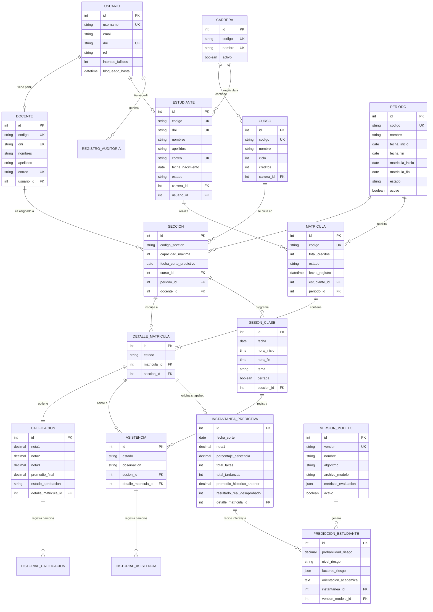

# DOCUMENTACIÓN TÉCNICA, BASE DE DATOS Y ARQUITECTURA DEL SISTEMA

## 1. INTRODUCCIÓN Y ALCANCE

El presente documento detalla la arquitectura técnica, el diseño de la base de datos relacional (modelos lógico y físico, diagrama entidad-relación) y la especificación funcional de los módulos del "Sistema web de gestión académica universitaria con análisis de datos y predicción de riesgo académico", desarrollado en Python y Django 5.2 LTS.

El sistema tiene como objetivo centralizar los procesos de gestión académica universitaria (estudiantes, docentes, asignaturas, matrículas, asistencia y calificaciones), incorporar análisis descriptivo de datos mediante Pandas y Plotly, y aplicar un pipeline reproducible de Machine Learning (Scikit-Learn) para la detección temprana del riesgo de desaprobación académica.

---

## 2. ARQUITECTURA Y ORGANIZACIÓN MODULAR

El proyecto se estructura bajo el patrón Modelo-Vista-Plantilla (MVT) de Django, complementado con una capa explícita de servicios de negocio (Service Layer) para desacoplar la lógica operativa de los controladores de vista.

### 2.1 Módulos del Sistema

1. **cuentas**: Gestión de identidad, autenticación, modelo de usuario personalizado (`Usuario`), control de acceso basado en roles (`ADMIN`, `DOCENTE`, `ESTUDIANTE`) y bitácora inmutable de auditoría (`RegistroAuditoria`).
2. **academico**: Catálogo institucional de programas (`Carrera`), asignaturas (`Curso`), calendarios (`Periodo`), plana profesoral (`Docente`), padrón de alumnos (`Estudiante`) y programación horaria (`Seccion`).
3. **matriculas**: Proceso transaccional de inscripción estudiantil (`Matricula`, `DetalleMatricula`), validación de prerrequisitos, control de vacantes mediante bloqueos pesimistas y anulación auditada.
4. **asistencia**: Control de sesiones de clase (`SesionClase`), registro diario en matriz (`Asistencia`), cálculo normalizado de porcentaje con exclusión de justificaciones y trazabilidad de cambios (`HistorialAsistencia`).
5. **calificaciones**: Planilla de evaluación vigesimal (`Calificacion`), cálculo aritmético exacto con punto decimal fijo (`Decimal`), redondeo simétrico (`ROUND_HALF_UP`), umbral de aprobación (>= 13.00) e historial de modificaciones (`HistorialCalificacion`).
6. **analitica**: Procesamiento analítico descriptivo con Pandas, generación de gráficos interactivos con Plotly y segmentación explícita de alertas normativas (reglas deterministas) vs inferencias estadísticas.
7. **predicciones**: Generación de instantáneas inmutables al primer corte evaluativo (`InstantaneaPredictiva`), entrenamiento reproducible con partición cronológica (train/val/test), evaluación de métricas de desaprobación, calibración de probabilidades (`VersionModelo`) y almacenamiento de inferencias (`PrediccionEstudiante`).
8. **reportes**: Generación de actas oficiales, constancias y sábanas de notas en formatos PDF (ReportLab) y Excel (openpyxl) con protección contra inyección de fórmulas.

---

## 3. MODELO ENTIDAD - RELACIÓN (MER)

A continuación se presenta el diagrama entidad-relación en notación Mermaid, detallando las entidades principales, sus atributos clave y las cardinalidades del sistema.

---

## 4. DICCIONARIO DE DATOS (MODELO FÍSICO)

A continuación se detalla la estructura física de las tablas generadas por el ORM de Django en MariaDB / SQLite, con sus tipos de datos, restricciones y propósitos.

### 4.1 Tabla: `cuentas_usuario`
Extiende `AbstractUser` para centralizar la autenticación y control de accesos.

| Campo | Tipo | Nulo | Restricción | Descripción |
|---|---|---|---|---|
| `id` | BIGINT | NO | PRIMARY KEY, AUTO_INCREMENT | Identificador único del usuario |
| `username` | VARCHAR(150) | NO | UNIQUE | Nombre de usuario para inicio de sesión |
| `password` | VARCHAR(128) | NO | - | Hash criptográfico de contraseña (PBKDF2/SHA256) |
| `first_name` | VARCHAR(150) | NO | - | Nombres del usuario |
| `last_name` | VARCHAR(150) | NO | - | Apellidos del usuario |
| `email` | VARCHAR(254) | NO | - | Correo institucional |
| `rol` | VARCHAR(15) | NO | CHECK (rol IN ('ADMIN','DOCENTE','ESTUDIANTE')) | Rol asignado en el sistema |
| `dni` | VARCHAR(8) | SI | UNIQUE | Documento Nacional de Identidad (8 dígitos) |
| `telefono` | VARCHAR(9) | SI | - | Teléfono celular (9 dígitos) |
| `avatar` | VARCHAR(100) | SI | - | Ruta del archivo de foto de perfil |
| `intentos_fallidos`| INT UNSIGNED | NO | DEFAULT 0 | Contador para prevención de fuerza bruta |
| `bloqueado_hasta` | DATETIME | SI | - | Marca de tiempo de bloqueo temporal |
| `is_active` | BOOLEAN | NO | DEFAULT TRUE | Estado de habilitación de la cuenta |
| `is_staff` | BOOLEAN | NO | DEFAULT FALSE | Acceso auxiliar a Django Admin técnico |
| `is_superuser` | BOOLEAN | NO | DEFAULT FALSE | Privilegios globales de administración |
| `date_joined` | DATETIME | NO | - | Fecha de registro en el sistema |

### 4.2 Tabla: `cuentas_registroauditoria`
Bitácora inmutable de eventos sensibles.

| Campo | Tipo | Nulo | Restricción | Descripción |
|---|---|---|---|---|
| `id` | BIGINT | NO | PRIMARY KEY, AUTO_INCREMENT | Identificador del evento de auditoría |
| `modulo` | VARCHAR(50) | NO | - | Módulo donde ocurrió la acción |
| `accion` | VARCHAR(50) | NO | - | Acción (CREAR, ACTUALIZAR, ANULAR, LOGIN, etc.) |
| `descripcion` | TEXT | NO | - | Detalle descriptivo de la operación |
| `ip_address` | VARCHAR(39) | SI | - | Dirección IP de procedencia |
| `fecha_hora` | DATETIME | NO | - | Marca de tiempo UTC/Local del evento |
| `usuario_id` | BIGINT | SI | FOREIGN KEY -> `cuentas_usuario(id)` | Usuario autor de la operación |

### 4.3 Tabla: `academico_carrera`
Programas profesionales de la universidad.

| Campo | Tipo | Nulo | Restricción | Descripción |
|---|---|---|---|---|
| `id` | BIGINT | NO | PRIMARY KEY, AUTO_INCREMENT | Identificador de la carrera |
| `codigo` | VARCHAR(10) | NO | UNIQUE | Código de programa (ej. ING-SIS) |
| `nombre` | VARCHAR(150) | NO | UNIQUE | Denominación de la carrera |
| `descripcion` | TEXT | SI | - | Descripción formativa |
| `activo` | BOOLEAN | NO | DEFAULT TRUE | Estado operativo |

### 4.4 Tabla: `academico_curso`
Asignaturas de la malla curricular.

| Campo | Tipo | Nulo | Restricción | Descripción |
|---|---|---|---|---|
| `id` | BIGINT | NO | PRIMARY KEY, AUTO_INCREMENT | Identificador del curso |
| `codigo` | VARCHAR(15) | NO | UNIQUE | Código de asignatura (ej. CS-101) |
| `nombre` | VARCHAR(150) | NO | - | Nombre de la asignatura |
| `ciclo` | SMALLINT UNSIGNED| NO | CHECK (ciclo BETWEEN 1 AND 12) | Ciclo formativo |
| `creditos` | SMALLINT UNSIGNED| NO | CHECK (creditos BETWEEN 1 AND 10) | Valor en créditos académicos |
| `activo` | BOOLEAN | NO | DEFAULT TRUE | Estado operativo |
| `carrera_id` | BIGINT | NO | FOREIGN KEY -> `academico_carrera(id)` | Carrera a la que pertenece el curso |

### 4.5 Tabla: `academico_periodo`
Semestres académicos regulares.

| Campo | Tipo | Nulo | Restricción | Descripción |
|---|---|---|---|---|
| `id` | BIGINT | NO | PRIMARY KEY, AUTO_INCREMENT | Identificador del periodo |
| `codigo` | VARCHAR(10) | NO | UNIQUE | Código de semestre (ej. 2025-1) |
| `nombre` | VARCHAR(50) | NO | - | Nombre descriptivo del semestre |
| `fecha_inicio` | DATE | NO | - | Fecha de inicio de clases |
| `fecha_fin` | DATE | NO | - | Fecha de fin de clases |
| `matricula_inicio`| DATE | NO | - | Fecha de inicio de periodo de matrícula |
| `matricula_fin` | DATE | NO | - | Fecha límite de matrícula |
| `estado` | VARCHAR(10) | NO | CHECK (estado IN ('ABIERTO','CERRADO')) | Estado operativo del periodo |
| `activo` | BOOLEAN | NO | DEFAULT FALSE | Indicador de periodo principal vigente |

### 4.6 Tabla: `academico_docente`
Plana de profesores.

| Campo | Tipo | Nulo | Restricción | Descripción |
|---|---|---|---|---|
| `id` | BIGINT | NO | PRIMARY KEY, AUTO_INCREMENT | Identificador del docente |
| `codigo` | VARCHAR(15) | NO | UNIQUE | Código de docente (ej. DOC-001) |
| `dni` | VARCHAR(8) | NO | UNIQUE | DNI de 8 dígitos |
| `nombres` | VARCHAR(100) | NO | - | Nombres del docente |
| `apellidos` | VARCHAR(100) | NO | - | Apellidos del docente |
| `correo` | VARCHAR(254) | NO | UNIQUE | Correo institucional |
| `telefono` | VARCHAR(9) | SI | - | Teléfono celular |
| `especialidad`| VARCHAR(150) | NO | - | Especialidad académica |
| `activo` | BOOLEAN | NO | DEFAULT TRUE | Estado laboral |
| `usuario_id` | BIGINT | NO | UNIQUE, FOREIGN KEY -> `cuentas_usuario(id)` | Cuenta de usuario vinculada |

### 4.7 Tabla: `academico_estudiante`
Padrón de estudiantes.

| Campo | Tipo | Nulo | Restricción | Descripción |
|---|---|---|---|---|
| `id` | BIGINT | NO | PRIMARY KEY, AUTO_INCREMENT | Identificador del estudiante |
| `codigo` | VARCHAR(15) | NO | UNIQUE | Código de estudiante (ej. EST-2025-001) |
| `dni` | VARCHAR(8) | NO | UNIQUE | DNI de 8 dígitos |
| `nombres` | VARCHAR(100) | NO | - | Nombres del estudiante |
| `apellidos` | VARCHAR(100) | NO | - | Apellidos del estudiante |
| `correo` | VARCHAR(254) | NO | UNIQUE | Correo institucional |
| `telefono` | VARCHAR(9) | SI | - | Teléfono celular |
| `fecha_nacimiento`| DATE | NO | - | Fecha de nacimiento |
| `estado` | VARCHAR(15) | NO | CHECK (estado IN ('ACTIVO','EGRESADO','RETIRADO','INACTIVO')) | Estado académico |
| `carrera_id` | BIGINT | NO | FOREIGN KEY -> `academico_carrera(id)` | Carrera cursada |
| `usuario_id` | BIGINT | NO | UNIQUE, FOREIGN KEY -> `cuentas_usuario(id)` | Cuenta de usuario vinculada |

### 4.8 Tabla: `academico_seccion`
Programación de secciones de cursos por periodo.

| Campo | Tipo | Nulo | Restricción | Descripción |
|---|---|---|---|---|
| `id` | BIGINT | NO | PRIMARY KEY, AUTO_INCREMENT | Identificador de la sección |
| `codigo_seccion` | VARCHAR(10) | NO | - | Código de sección (01, A, etc.) |
| `capacidad_maxima`| SMALLINT UNSIGNED| NO | DEFAULT 30 | Límite máximo de inscritos |
| `fecha_corte_predictivo`| DATE | NO | - | Fecha inmutable de corte de snapshot ML |
| `activo` | BOOLEAN | NO | DEFAULT TRUE | Estado de habilitación |
| `curso_id` | BIGINT | NO | FOREIGN KEY -> `academico_curso(id)` | Asignatura dictada |
| `periodo_id` | BIGINT | NO | FOREIGN KEY -> `academico_periodo(id)` | Periodo académico |
| `docente_id` | BIGINT | NO | FOREIGN KEY -> `academico_docente(id)` | Docente a cargo |
| - | - | - | UNIQUE (`curso_id`, `periodo_id`, `codigo_seccion`) | No duplicidad de secciones |

### 4.9 Tabla: `matriculas_matricula`
Matrícula de un estudiante en un semestre.

| Campo | Tipo | Nulo | Restricción | Descripción |
|---|---|---|---|---|
| `id` | BIGINT | NO | PRIMARY KEY, AUTO_INCREMENT | Identificador de la matrícula |
| `codigo` | VARCHAR(25) | NO | UNIQUE | Código de matrícula (ej. MAT-2025-1-00001) |
| `total_creditos` | SMALLINT UNSIGNED| NO | DEFAULT 0 | Suma total de créditos matriculados |
| `estado` | VARCHAR(15) | NO | CHECK (estado IN ('REGISTRADA','ANULADA')) | Estado de la matrícula |
| `motivo_anulacion`| TEXT | SI | - | Sustento formal en caso de anulación |
| `fecha_registro` | DATETIME | NO | - | Fecha y hora de procesamiento |
| `fecha_anulacion` | DATETIME | SI | - | Fecha y hora de anulación |
| `estudiante_id` | BIGINT | NO | FOREIGN KEY -> `academico_estudiante(id)` | Estudiante titular |
| `periodo_id` | BIGINT | NO | FOREIGN KEY -> `academico_periodo(id)` | Periodo académico |
| `usuario_registro_id` | BIGINT | SI | FOREIGN KEY -> `cuentas_usuario(id)` | Usuario que registró la matrícula |
| `usuario_anulacion_id`| BIGINT | SI | FOREIGN KEY -> `cuentas_usuario(id)` | Usuario que ejecutó la anulación |

### 4.10 Tabla: `matriculas_detallematricula`
Inscripción específica en una sección.

| Campo | Tipo | Nulo | Restricción | Descripción |
|---|---|---|---|---|
| `id` | BIGINT | NO | PRIMARY KEY, AUTO_INCREMENT | Identificador del detalle |
| `estado` | VARCHAR(15) | NO | CHECK (estado IN ('INSCRITO','RETIRADO','ANULADO')) | Estado de inscripción |
| `fecha_registro` | DATETIME | NO | - | Fecha de inscripción |
| `matricula_id` | BIGINT | NO | FOREIGN KEY -> `matriculas_matricula(id)` | Matrícula contenedora |
| `seccion_id` | BIGINT | NO | FOREIGN KEY -> `academico_seccion(id)` | Sección inscrita |
| - | - | - | UNIQUE (`matricula_id`, `seccion_id`) | No duplicidad de curso por matrícula |

### 4.11 Tabla: `asistencia_sesionclase`
Sesiones de clase programadas.

| Campo | Tipo | Nulo | Restricción | Descripción |
|---|---|---|---|---|
| `id` | BIGINT | NO | PRIMARY KEY, AUTO_INCREMENT | Identificador de la sesión |
| `fecha` | DATE | NO | - | Fecha de la clase |
| `hora_inicio` | TIME | NO | - | Hora de inicio |
| `hora_fin` | TIME | NO | - | Hora de fin |
| `tema` | VARCHAR(255) | SI | - | Contenido pedagógico tratado |
| `cerrada` | BOOLEAN | NO | DEFAULT FALSE | Estado de cierre oficial |
| `fecha_cierre` | DATETIME | SI | - | Momento de cierre de la sesión |
| `seccion_id` | BIGINT | NO | FOREIGN KEY -> `academico_seccion(id)` | Sección correspondiente |
| `cerrada_por_id`| BIGINT | SI | FOREIGN KEY -> `cuentas_usuario(id)` | Usuario que cerró la sesión |
| - | - | - | UNIQUE (`seccion_id`, `fecha`, `hora_inicio`) | Evita sesiones duplicadas simultáneas |

### 4.12 Tabla: `asistencia_asistencia`
Registro individual de asistencia por sesión y alumno.

| Campo | Tipo | Nulo | Restricción | Descripción |
|---|---|---|---|---|
| `id` | BIGINT | NO | PRIMARY KEY, AUTO_INCREMENT | Identificador de asistencia |
| `estado` | VARCHAR(15) | NO | CHECK (estado IN ('PRESENTE','TARDANZA','FALTA','JUSTIFICADA')) | Estado registrado |
| `observacion` | VARCHAR(255) | SI | - | Justificación u observación |
| `fecha_registro` | DATETIME | NO | - | Fecha de creación |
| `ultima_modificacion`| DATETIME | NO | - | Fecha de última actualización |
| `sesion_id` | BIGINT | NO | FOREIGN KEY -> `asistencia_sesionclase(id)` | Sesión de clase |
| `detalle_matricula_id`| BIGINT | NO | FOREIGN KEY -> `matriculas_detallematricula(id)` | Inscripción del estudiante |
| - | - | - | UNIQUE (`sesion_id`, `detalle_matricula_id`) | Una asistencia por estudiante y sesión |

### 4.13 Tabla: `calificaciones_calificacion`
Evaluaciones vigesimales y promedio de asignatura.

| Campo | Tipo | Nulo | Restricción | Descripción |
|---|---|---|---|---|
| `id` | BIGINT | NO | PRIMARY KEY, AUTO_INCREMENT | Identificador de calificación |
| `nota1` | DECIMAL(4,2)| SI | CHECK (nota1 BETWEEN 0.00 AND 20.00) | Evaluación 1 (N1) |
| `nota2` | DECIMAL(4,2)| SI | CHECK (nota2 BETWEEN 0.00 AND 20.00) | Evaluación 2 (N2) |
| `nota3` | DECIMAL(4,2)| SI | CHECK (nota3 BETWEEN 0.00 AND 20.00) | Evaluación 3 (N3) |
| `promedio_final` | DECIMAL(4,2)| SI | CHECK (promedio_final BETWEEN 0.00 AND 20.00) | Promedio final calculado |
| `estado_aprobacion`| VARCHAR(15) | NO | CHECK (estado_aprobacion IN ('APROBADO','DESAPROBADO','PENDIENTE')) | Resultado académico |
| `fecha_registro` | DATETIME | NO | - | Fecha de creación |
| `ultima_modificacion`| DATETIME | NO | - | Fecha de último cambio |
| `detalle_matricula_id`| BIGINT | NO | UNIQUE, FOREIGN KEY -> `matriculas_detallematricula(id)` | Relación uno a uno con inscripción |

### 4.14 Tabla: `calificaciones_historialcalificacion`
Auditoría de cambios de notas.

| Campo | Tipo | Nulo | Restricción | Descripción |
|---|---|---|---|---|
| `id` | BIGINT | NO | PRIMARY KEY, AUTO_INCREMENT | Identificador del cambio |
| `evaluacion` | VARCHAR(20) | NO | - | Evaluación modificada (N1, N2, N3) |
| `nota_anterior`| DECIMAL(4,2)| SI | - | Valor previo de la nota |
| `nota_nueva` | DECIMAL(4,2)| SI | - | Nuevo valor asignado |
| `motivo_cambio`| TEXT | NO | - | Justificación de la modificación |
| `fecha_cambio` | DATETIME | NO | - | Marca de tiempo del cambio |
| `calificacion_id`| BIGINT | NO | FOREIGN KEY -> `calificaciones_calificacion(id)`| Calificación afectada |
| `modificado_por_id`| BIGINT | SI | FOREIGN KEY -> `cuentas_usuario(id)` | Usuario responsable |

### 4.15 Tabla: `predicciones_instantaneapredictiva`
Instantánea inmutable de datos conocidos a la fecha de corte.

| Campo | Tipo | Nulo | Restricción | Descripción |
|---|---|---|---|---|
| `id` | BIGINT | NO | PRIMARY KEY, AUTO_INCREMENT | Identificador del snapshot |
| `fecha_corte` | DATE | NO | - | Fecha de corte utilizada |
| `nota1` | DECIMAL(4,2)| SI | - | Nota 1 registrada al corte |
| `porcentaje_asistencia`| DECIMAL(5,2)| SI | - | Porcentaje de asistencia al corte |
| `total_faltas` | SMALLINT UNSIGNED| NO | DEFAULT 0 | Inasistencias acumuladas al corte |
| `total_tardanzas` | SMALLINT UNSIGNED| NO | DEFAULT 0 | Tardanzas acumuladas al corte |
| `sesiones_consideradas`| SMALLINT UNSIGNED| NO | DEFAULT 0 | Cantidad de sesiones válidas al corte |
| `promedio_historico_anterior`| DECIMAL(4,2)| SI | - | Promedio histórico de semestres previos |
| `cursos_desaprobados_anteriores`| SMALLINT UNSIGNED| NO | DEFAULT 0 | Cantidad de cursos reprobados previos |
| `sin_historial_previo`| BOOLEAN | NO | DEFAULT FALSE | Flag: Alumno sin historial anterior |
| `resultado_real_desaprobado`| SMALLINT UNSIGNED| SI | CHECK (resultado_real_desaprobado IN (0,1)) | Variable objetivo real (1=Desaprobado, 0=Aprobado) |
| `promedio_final_real`| DECIMAL(4,2)| SI | - | Promedio final obtenido al cierre |
| `es_sintetico` | BOOLEAN | NO | DEFAULT FALSE | Identificador de dato sintético |
| `detalle_matricula_id`| BIGINT | NO | UNIQUE, FOREIGN KEY -> `matriculas_detallematricula(id)` | Inscripción analizada |

### 4.16 Tabla: `predicciones_versionmodelo`
Registro de modelos predictivos serializados y evaluados.

| Campo | Tipo | Nulo | Restricción | Descripción |
|---|---|---|---|---|
| `id` | BIGINT | NO | PRIMARY KEY, AUTO_INCREMENT | Identificador del modelo |
| `version` | VARCHAR(30) | NO | UNIQUE | Identificador de versión (ej. v1.0-logreg) |
| `nombre` | VARCHAR(150) | NO | - | Nombre descriptivo del modelo |
| `algoritmo` | VARCHAR(25) | NO | - | Algoritmo (DUMMY, LOGISTIC, DECISION_TREE) |
| `archivo_modelo` | VARCHAR(255) | NO | - | Ruta del artefacto `.joblib` en disco |
| `metricas_evaluacion`| JSON | NO | - | Métricas (Recall, F1, Matriz de Confusión, etc.) |
| `umbral_decision`| DOUBLE | NO | DEFAULT 0.50 | Umbral de clasificación |
| `variables_utilizadas`| JSON | NO | - | Lista de variables de entrada del modelo |
| `activo` | BOOLEAN | NO | DEFAULT FALSE | Indicador de modelo en producción |
| `es_sintetico` | BOOLEAN | NO | DEFAULT FALSE | Flag de entrenamiento sintético |
| `fecha_entrenamiento`| DATETIME | NO | - | Fecha de entrenamiento y validación |

### 4.17 Tabla: `predicciones_prediccionestudiante`
Resultados de inferencia de riesgo por inscripción.

| Campo | Tipo | Nulo | Restricción | Descripción |
|---|---|---|---|---|
| `id` | BIGINT | NO | PRIMARY KEY, AUTO_INCREMENT | Identificador de predicción |
| `probabilidad_riesgo`| DECIMAL(5,4)| NO | - | Probabilidad estimada de desaprobar (0.0000 a 1.0000) |
| `nivel_riesgo` | VARCHAR(20) | NO | CHECK (nivel_riesgo IN ('BAJO','MEDIO','ALTO','INSUFICIENTE')) | Nivel cualitativo |
| `calibrado` | BOOLEAN | NO | DEFAULT FALSE | Indicador de calibración probabilística |
| `factores_riesgo` | JSON | NO | - | Variables observadas al corte |
| `orientacion_academica`| TEXT | SI | - | Recomendación pedagógica sugerida |
| `fecha_prediccion`| DATETIME | NO | - | Marca de tiempo de la inferencia |
| `instantanea_id`| BIGINT | NO | FOREIGN KEY -> `predicciones_instantaneapredictiva(id)` | Snapshot de entrada |
| `version_modelo_id`| BIGINT | NO | FOREIGN KEY -> `predicciones_versionmodelo(id)` | Modelo generador |
| - | - | - | UNIQUE (`instantanea_id`, `version_modelo_id`) | Inferencia única por snapshot y modelo |

---

## 5. FUNCIONAMIENTO DE LOS MÓDULOS DEL SISTEMA

### 5.1 Módulo de Matrículas (Transacciones Atómicas y Concurrencia)
* **Pre-Matrícula:** Valida que el estudiante se encuentre en estado `ACTIVO`, que el periodo esté en intervalo de matrícula y que no existan cursos duplicados entre las secciones seleccionadas.
* **Bloqueo Pesimista:** Ejecuta `@transaction.atomic` y bloquea las filas de las secciones seleccionadas con `select_for_update()`. Verifica que `vacantes_disponibles > 0` antes de confirmar.
* **Inicialización:** Crea automáticamente las entidades `Matricula`, `DetalleMatricula` y `Calificacion` (en estado `PENDIENTE`) para cada asignatura.
* **Anulación:** Actualiza el estado a `ANULADA`, revierte las vacantes ocupadas a disponibles y exige el registro obligatorio de un motivo formal para auditoría.

### 5.2 Módulo de Calificaciones (Precisión Decimal y Redondeo)
* **Regla de Promedio:**
  $$\text{Promedio Final} = \text{ROUND\_HALF\_UP}\left(\frac{\text{Nota 1} + \text{Nota 2} + \text{Nota 3}}{3}, 2\right)$$
* **Aprobación:** Si $\text{Promedio Final} \ge 13.00 \Rightarrow \text{APROBADO}$; caso contrario $\Rightarrow \text{DESAPROBADO}$.
* **Tratamiento de Nulos:** Una nota no ingresada (`None`) mantiene el promedio en estado `PENDIENTE`. La nota `0.00` es tratada como valor numérico válido.
* **Trazabilidad:** Cualquier edición genera un registro en `HistorialCalificacion` con valor anterior, nuevo, usuario y motivo.

### 5.3 Módulo de Asistencia (Normalización y Cierre de Sesiones)
* **Cálculo:**
  $$\text{Porcentaje de Asistencia} = \frac{\text{Presentes} + \text{Tardanzas}}{\text{Total Sesiones Cerradas} - \text{Justificadas}} \times 100$$
* **Cierre de Sesión:** Una sesión se marca como cerrada cuando todos los alumnos inscritos poseen estado asignado. Únicamente las sesiones cerradas participan en el porcentaje acumulado y en los reportes oficiales.

### 5.4 Módulo de Analítica y Visualización de Datos
* **Pandas & Plotly:** Genera agregaciones estadísticas de inscripciones por carrera, histogramas de distribución de notas finales con líneas de corte en 13.00, matrices de aprobación por sección y trayectorias de evolución individual.
* **Distinción Conceptual:**
  * *Estadística Descriptiva:* Datos observados consolidados.
  * *Alerta Normativa:* Regla determinista (ej. Asistencia < 70% o Nota 1 < 10.50).
  * *Predicción ML:* Estimación probabilística derivada del modelo matemático.

### 5.5 Módulo de Machine Learning (Predicción de Riesgo)
* **Prevención de Data Leakage:** Las características predictivas se extraen estrictamente antes de la fecha de corte (Evaluación 1, asistencia al corte, historial cerrado previo). Se prohíbe el uso de notas futuras o datos personales.
* **Partición Cronológica:** Entrenamiento en periodos antiguos (2024-1, 2024-2) y prueba en periodos posteriores cerrados (2025-1).
* **Métricas Evaluadas:** Recall de desaprobación (capacidad de detectar al alumno en riesgo), Precision, F1-Score, Matriz de Confusión y Brier Score para calibración.
* **Inferencia y Orientación:** La probabilidad se traduce en niveles (Bajo, Medio, Alto) acompañados de sugerencias de tutoría pedagógica.
