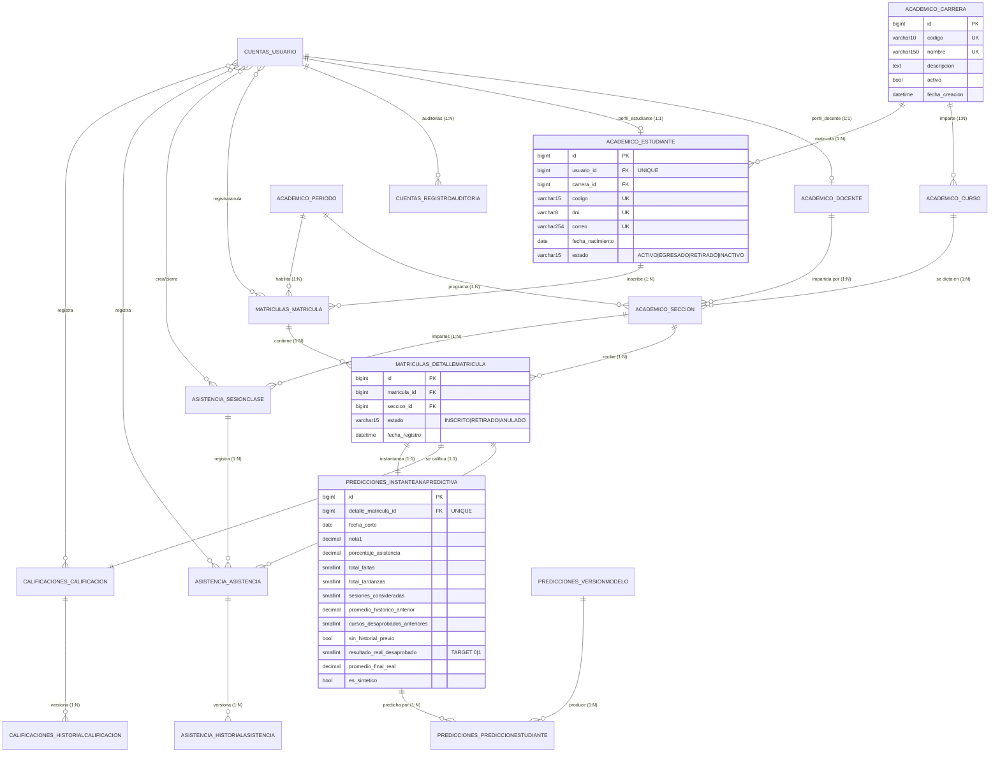

# MODELO DE DATOS, RELACIONES DE ENTIDADES Y FLUJOS DE DATOS

**Proyecto:** Sistema Web de Gestión Académica Universitaria con Análisis de Datos y Predicción de Riesgo Académico
**Stack:** Python 3.12 · Django 5.2.17 · SQLite (dev) / MariaDB 11 (prod) · Scikit-Learn · Pandas · Plotly · ReportLab · openpyxl
**Base de datos activa analizada:** `db.sqlite3` (1.736.704 bytes)

---

## 0. METODOLOGÍA Y FUENTES DE VERIFICACIÓN

Este documento **no se elaboró a partir de los modelos en su forma declarativa**, sino reconstruyendo el esquema a partir de tres fuentes cruzadas:

| # | Fuente | Qué aporta |
|---|---|---|
| 1 | **Migraciones** (`*/migrations/*.py`) — 8 archivos, 7 apps | Estado declarativo congelado de las tablas: tipos exactos de columna, `on_delete`, `unique_together`, `swappable_dependency`, grafo de dependencias |
| 2 | **`sqlite_master`** de `db.sqlite3` | Esquema físico **real y efectivo**: DDL, índices creados, `CHECK` de SQLite, y volumetría actual de cada tabla |
| 3 | **Capa de servicios y comandos** (`*/services.py`, `*/ml_service.py`, `*/management/commands/*.py`) | Semántica de negocio, fórmulas, transacciones, puntos de entrada |

> **Hallazgo metodológico clave:** el esquema físico difiere de las migraciones en detalles relevantes para el análisis (p. ej. `PositiveSmallIntegerField` se materializa como `smallint unsigned` con `CHECK (... >= 0)`; `JSONField` se materializa como `text` con `CHECK (JSON_VALID(...))`). Ambos niveles se documentan.

### 0.1 Inventario de migraciones (estado real)

| App | Archivo | Operaciones | Dependencias |
|---|---|---|---|
| `cuentas` | `0001_initial.py` | `CreateModel(Usuario)`, `CreateModel(RegistroAuditoria)` | `auth.0012` |
| `academico` | `0001_initial.py` | `CreateModel(Carrera, Docente, Estudiante, Periodo, Seccion, Curso)` | *(ninguna)* |
| `academico` | `0002_initial.py` | `AddField` × 5, `AlterUniqueTogether` × 2 | `academico.0001`, `swappable(AUTH_USER_MODEL)` |
| `matriculas` | `0001_initial.py` | `CreateModel(Matricula)`, `CreateModel(DetalleMatricula)` | `academico.0001`, `swappable` |
| `asistencia` | `0001_initial.py` | `CreateModel(Asistencia, HistorialAsistencia, SesionClase)` | *(ninguna)* |
| `asistencia` | `0002_initial.py` | `AddField` × 8, `AlterUniqueTogether` × 2 | `academico.0002`, `asistencia.0001`, `matriculas.0001`, `swappable` |
| `calificaciones` | `0001_initial.py` | `CreateModel(Calificacion, HistorialCalificacion)` | *(ninguna)* |
| `calificaciones` | `0002_initial.py` | `AddField` × 4 | `calificaciones.0001`, `matriculas.0001`, `swappable` |
| `predicciones` | `0001_initial.py` | `CreateModel(InstantaneaPredictiva, VersionModelo, PrediccionEstudiante)` | `matriculas.0001`, `swappable` |
| `analitica` | *(solo `__init__.py`)* | — | — |
| `reportes` | *(solo `__init__.py`)* | — | — |

**Total: 18 tablas de dominio · 30 claves foráneas · 5 restricciones `unique_together` · 0 apps con signals.**

### 0.2 Grafo de dependencias de migraciones

```
auth.0012
    │
    ▼
cuentas.0001 ──────────────────────────────────┐
    │                                           │
    ▼                                           │
academico.0001 ──► academico.0002 ─────────────┤
    │                                           │
    ├──► matriculas.0001 ──────┬───────────────┼──► calificaciones.0002
    │                           │               │         ▲
    │                           │               │    calificaciones.0001
    │                           ▼               │         ▲
    │                  asistencia.0002 ◄──────┘         │
    │                       ▲                           │
    │            asistencia.0001                      │
    │                                                  │
    └──────────────────────────────────────────► predicciones.0001
```

**Partición en dos fases por app (patrón `swappable_dependency`):** todas las apps quedan deliberadamente divididas en un `0001_initial` sin dependencias externas (tablas puramente locales) y un `0002_initial` que añade las FKs a `cuentas.Usuario` y a entidades de `academico`/`matriculas`. Esto rompe el **ciclo de dependencias** `academico → cuentas → (vía admin) → academico` que Django no puede resolver en un único `initial`.

> ⚠️ **Observación:** `academico.0001` crea `Seccion` **sin** `curso_id`, `periodo_id` ni `docente_id` (tabla huérfana y sin `NOT NULL`); `asistencia.0001` crea `Asistencia` sin `sesion_id` ni `detalle_matricula_id`; `calificaciones.0001` crea `Calificacion` con `Meta.ordering` que atraviesa **FKs que aún no existen**. Si una migración se interrumpe entre fases, el esquema queda inconsistente y Django no puede re-aplicar `0002` de forma segura sin `migrate --fake`.

---

## 1. DIAGRAMA ENTIDAD-RELACIÓN COMPLETO



---

## 2. CATÁLOGO DE ENTIDADES POR APLICACIÓN

### 2.1 `cuentas` — Identidad, roles y trazabilidad

#### `cuentas_usuario` — `Usuario` (extiende `AbstractUser`)

**Rol:** raíz de seguridad. Es `AUTH_USER_MODEL` y padre de 8 FKs.

| Columna | Tipo físico | Null | Restricción | Origen |
|---|---|---|---|---|
| `id` | `integer PK AUTOINCREMENT` | NO | PK | Django (`BigAutoField`) |
| `password` | `varchar(128)` | NO | | `AbstractUser` |
| `last_login` | `datetime` | SÍ | | `AbstractUser` |
| `is_superuser` | `bool` | NO | | `AbstractUser` |
| `username` | `varchar(150)` | NO | **UNIQUE** | `AbstractUser` |
| `first_name` | `varchar(150)` | NO | | `AbstractUser` |
| `last_name` | `varchar(150)` | NO | | `AbstractUser` |
| `email` | `varchar(254)` | NO | | `AbstractUser` |
| `is_staff` / `is_active` | `bool` | NO | | `AbstractUser` |
| `date_joined` | `datetime` | NO | `DEFAULT now()` | `AbstractUser` |
| `rol` | `varchar(15)` | NO | `ADMIN\|DOCENTE\|ESTUDIANTE` (def. `ADMIN`) | propio |
| `dni` | `varchar(8)` | SÍ | **UNIQUE** `^\d{8}$` | propio |
| `telefono` | `varchar(9)` | SÍ | `^9\d{8}$` | propio |
| `avatar` | `varchar(100)` | SÍ | `upload_to='avatars/'` | propio |
| `intentos_fallidos` | `integer unsigned CHECK >= 0` | NO | def. `0` | propio (anti-fuerza bruta) |
| `bloqueado_hasta` | `datetime` | SÍ | | propio (anti-fuerza bruta) |

**M2M:** `cuentas_usuario_groups` → `auth_group` (UNIQUE `usuario_id, group_id`) · `cuentas_usuario_user_permissions` → `auth_permission` (UNIQUE `usuario_id, permission_id`)

**Propiedades de dominio:** `es_admin` (rol `ADMIN` **o** `is_superuser`), `es_docente`, `es_estudiante`
**Orden:** `['username']`
**Volumen real:** 69 filas

#### `cuentas_registroauditoria` — `RegistroAuditoria`

Bitácora append-only de trazabilidad. **No tiene entidad inversa ni flujo de borrado**: es terminal.

| Columna | Tipo | Null | FK destino | `on_delete` |
|---|---|---|---|---|
| `id` | `integer PK` | NO | — | — |
| `usuario_id` | `bigint` | SÍ | `cuentas_usuario` | **`SET_NULL`** |
| `modulo` | `varchar(50)` | NO | — | — |
| `accion` | `varchar(50)` | NO | — | — |
| `descripcion` | `text` | NO | — | — |
| `ip_address` | `char(39)` | SÍ | — | — |
| `fecha_hora` | `datetime` | NO | — | `auto_now_add` |

**Índice:** `cuentas_registroauditoria_usuario_id` · **Orden:** `['-fecha_hora']`
**Decisión de diseño:** `SET_NULL` garantiza que eliminar un usuario **nunca** destruye evidencia histórica; la fila de auditoría sobrevive huérfana.
**Volumen real:** 5 filas (los datos de demostración no ejercitan la auditoría).

---

### 2.2 `academico` — Datos maestros institucionales

#### `academico_carrera` — `Carrera`
Raíz del catálogo. PK surrogate; identidad por negocio en `codigo`.

| Columna | Tipo | Restricción |
|---|---|---|
| `codigo` | `varchar(10)` | **UNIQUE** |
| `nombre` | `varchar(150)` | **UNIQUE** |
| `descripcion` | `text` | NULL |
| `activo` | `bool` | def. `True` |
| `fecha_creacion` | `datetime` | `auto_now_add` |

**FK salientes:** ninguna · **Orden:** `['nombre']` · **Volumen:** 4

#### `academico_curso` — `Curso`

| Columna | Tipo | Restricción |
|---|---|---|
| `codigo` | `varchar(15)` | **UNIQUE** (además del `unique_together`) |
| `nombre` | `varchar(150)` | |
| `carrera_id` | `bigint` | **FK → `academico_carrera`, `PROTECT`** |
| `ciclo` | `smallint unsigned CHECK >= 0` | validadores `1..12` |
| `creditos` | `smallint unsigned CHECK >= 0` | validadores `1..10`, def. `3` |

**`unique_together`:** `(codigo, carrera_id)` → índice `academico_curso_codigo_carrera_id_667266ba_uniq`
**Índices:** `academico_curso_carrera_id_8eaba159` · **Orden:** `['carrera','ciclo','nombre']` · **Volumen:** 18

> ⚠️ **Redundancia de unicidad:** `codigo` es `unique=True` **y** participa de `unique_together ('codigo','carrera')`. El `unique_together` es lógicamente redundante y solo añade un índice. Ningún flujo depende de que el mismo código exista en dos carreras.

#### `academico_periodo` — `Periodo`

| Columna | Tipo | Restricción |
|---|---|---|
| `codigo` | `varchar(10)` | **UNIQUE** (formato `AAAA-1`) |
| `nombre` | `varchar(50)` | |
| `fecha_inicio` / `fecha_fin` | `date` | `fecha_inicio < fecha_fin` |
| `matricula_inicio` / `matricula_fin` | `date` | `matricula_inicio <= matricula_fin <= fecha_fin` |
| `estado` | `varchar(10)` | `ABIERTO` \| `CERRADO` |
| `activo` | `bool` | def. `False` — "periodo vigente" |

**Sin `unique_together` para `activo`.** El invariante "solo un periodo activo" se aplica **exclusivamente en la capa de aplicación** (`academico/views.py:119-127` y `:136-144`), con un `UPDATE` masivo seguido de `save()`, **sin `transaction.atomic`**.

**`clean()` validado** (`academico/models.py:86-92`), invocado únicamente vía `PeriodoForm._post_clean`.
**Métodos de dominio:** `esta_en_intervalo_matricula(fecha=None)` → `matricula_inicio <= fecha <= matricula_fin AND estado == ABIERTO`; `esta_cerrado` → `estado == CERRADO`.
**Orden:** `['-fecha_inicio']` · **Volumen:** 4 (3 `CERRADO` + 1 `ABIERTO/activo`)

> **Impacto transaccional:** `esta_cerrado` es el interruptor de **inmutabilidad** de todo el sistema. Lee 4 servicios (matrícula, anulación, asistencia, calificaciones) y bloquea escrituras históricas.

#### `academico_docente` — `Docente`

| Columna | Tipo | Restricción |
|---|---|---|
| `usuario_id` | `bigint` | **FK → `cuentas_usuario`, `CASCADE`, UNIQUE** (1:1) |
| `codigo` | `varchar(15)` | **UNIQUE** |
| `dni` | `varchar(8)` | **UNIQUE** `^\d{8}$` |
| `nombres` / `apellidos` | `varchar(100)` | |
| `correo` | `varchar(254)` | **UNIQUE** |
| `telefono` | `varchar(9)` | NULL |
| `especialidad` | `varchar(150)` | |
| `activo` | `bool` | def. `True` |

**Índices:** `academico_docente_usuario_id` (implícito por `UNIQUE`)
**Relación clave:** `CASCADE` en `usuario_id` ⇒ borrar la **cuenta** borra al docente, y en cascada intentaría borrar sus secciones — pero `Seccion.docente_id` es `PROTECT`, por lo que **Django bloquea el borrado del usuario** si el docente tiene secciones.La combinación de `CASCADE` + `PROTECT` actúa como protección en dos niveles.
**Orden:** `['apellidos','nombres']` · **Volumen:** 8

#### `academico_estudiante` — `Estudiante`

| Columna | Tipo | Restricción |
|---|---|---|
| `usuario_id` | `bigint` | **FK → `cuentas_usuario`, `CASCADE`, UNIQUE** (1:1) |
| `carrera_id` | `bigint` | **FK → `academico_carrera`, `PROTECT`** |
| `codigo` | `varchar(15)` | **UNIQUE** (`EST-2024-001`) |
| `dni` | `varchar(8)` | **UNIQUE** `^\d{8}$` |
| `nombres` / `apellidos` | `varchar(100)` | |
| `correo` | `varchar(254)` | **UNIQUE** |
| `telefono` | `varchar(9)` | NULL |
| `fecha_nacimiento` | `date` | |
| `estado` | `varchar(15)` | `ACTIVO` \| `EGRESADO` \| `RETIRADO` \| `INACTIVO` |

**Índices:** `academico_estudiante_carrera_id_562aa665`, `academico_estudiante_usuario_id` (implícito)
**Propiedades:** `nombre_completo`
**Orden:** `['apellidos','nombres']` · **Volumen:** 60

> **Dato de identidad duplicado:** `dni` y `correo` existen **tanto en `cuentas_usuario` como en `academico_estudiante`/`academico_docente`**, con constraint `UNIQUE` en cada tabla pero **sin restricción cruzada**. El sistema admite teóricamente dos estudiantes con el mismo DNI si uno tiene cuenta y el otro no, o dos filas con el mismo DNI si difieren en `Usuario`. El login acepta `username` **o** `email` **o** `dni` (`cuentas/views.py:29-30`), lo que agrava la ambigüedad.

#### `academico_seccion` — `Seccion` ★ *Nodo de confluencia del modelo*

Es la entidad donde converge casi todo el modelo de datos: une `Curso` + `Periodo` + `Docente`, y es la unidad de capacidad que consume `DetalleMatricula`.

| Columna | Tipo | Restricción |
|---|---|---|
| `curso_id` | `bigint` | **FK → `academico_curso`, `PROTECT`** |
| `periodo_id` | `bigint` | **FK → `academico_periodo`, `PROTECT`** |
| `docente_id` | `bigint` | **FK → `academico_docente`, `PROTECT`** |
| `codigo_seccion` | `varchar(10)` | `01`, `A`… |
| `capacidad_maxima` | `smallint unsigned CHECK >= 0` | def. `30`, validadores `1..150` |
| `fecha_corte_predictivo` | `date` | debe estar dentro de `[periodo.fecha_inicio, periodo.fecha_fin]` |
| `activo` | `bool` | def. `True` |

**`unique_together`:** `(curso_id, periodo_id, codigo_seccion)` → `academico_seccion_curso_id_periodo_id_codigo_seccion_754a7cc7_uniq`
**Índices:** `academico_seccion_curso_id_45856ce0`, `_periodo_id_fe945787`, `_docente_id_8f76d953`
**Orden:** `['periodo','curso','codigo_seccion']` · **Volumen:** 72

**Propiedades de capacidad** (`academico/models.py:212-222`) — la primitiva de control de vacantes:
```python
@property
def vacantes_ocupadas(self):
    return self.inscripciones.filter(matricula__estado='REGISTRADA', estado='INSCRITO').count()

@property
def vacantes_disponibles(self):
    return max(0, self.capacidad_maxima - self.vacantes_ocupadas)

@property
def tiene_vacantes(self):
    return self.vacantes_disponibles > 0
```
> **Semántica clave:** la vacante se libera por **doble condición** — el estado de la cabecera (`Matricula.estado == 'REGISTRADA'`) **y** el del detalle (`DetalleMatricula.estado == 'INSCRITO'`). La anulación en cascada lógica solo necesita mover el detalle.

**`clean()`** valida que `fecha_corte_predictivo` esté dentro del rango del periodo — **es la pieza que ancla el diseño anti-fuga de datos del módulo ML**: la fecha de corte es un dato del modelo relacional, no un parámetro del pipeline.

---

### 2.3 `matriculas` — Núcleo transaccional de inscripción

#### `matriculas_matricula` — `Matricula` (cabecera)

| Columna | Tipo | Null | FK destino | `on_delete` |
|---|---|---|---|---|
| `codigo` | `varchar(25)` | NO | — | **UNIQUE** (`MAT-{periodo}-{00001}`) |
| `estudiante_id` | `bigint` | NO | `academico_estudiante` | **`PROTECT`** |
| `periodo_id` | `bigint` | NO | `academico_periodo` | **`PROTECT`** |
| `fecha_registro` | `datetime` | NO | — | `auto_now_add` |
| `estado` | `varchar(15)` | NO | — | `REGISTRADA` \| `ANULADA` |
| `total_creditos` | `smallint unsigned` | NO | — | def. `0` (desnormalizado) |
| `motivo_anulacion` | `text` | SÍ | — | auditoría de anulación |
| `usuario_registro_id` | `bigint` | SÍ | `cuentas_usuario` | **`SET_NULL`** |
| `usuario_anulacion_id` | `bigint` | SÍ | `cuentas_usuario` | **`SET_NULL`** |
| `fecha_anulacion` | `datetime` | SÍ | — | |

**Índices:** `_estudiante_id_a4d674f7`, `_periodo_id_f08326cb`, `_usuario_anulacion_id_e6409aec`, `_usuario_registro_id_63b152f7`
**Orden:** `['-fecha_registro']` · **Propiedad:** `es_valida` · **Volumen:** 240

> **Ausencia crítica de constraint:** no existe `unique_together (estudiante_id, periodo_id)`. La unicidad "una matrícula por estudiante por periodo" se valida **solo** en aplicación (`matriculas/services.py:25-31`, filtrando `estado='REGISTRADA'`). Consecuencia directa: **una matrícula `ANULADA` no bloquea reinscripción** (diseño intencional), pero dos procesos concurrentes podrían insertar dos cabeceras `REGISTRADA` para la misma pareja en el motor por defecto.

#### `matriculas_detallematricula` — `DetalleMatricula` ★ *Tabla pivote más crítica del sistema*

Une `Matricula` (intención del estudiante + periodo) con `Seccion` (asignatura + docente + capacidad). Es **la entidad vertebral**: de ella cuelgan calificaciones, asistencias e instantáneas ML.

| Columna | Tipo | Null | FK destino | `on_delete` |
|---|---|---|---|---|
| `matricula_id` | `bigint` | NO | `matriculas_matricula` | **`CASCADE`** |
| `seccion_id` | `bigint` | NO | `academico_seccion` | **`PROTECT`** |
| `estado` | `varchar(15)` | NO | — | `INSCRITO` \| `RETIRADO` \| `ANULADO` |
| `fecha_registro` | `datetime` | NO | — | `auto_now_add` |

**`unique_together`:** `(matricula_id, seccion_id)` → `matriculas_detallematricula_matricula_id_seccion_id_17c98504_uniq`
**Índices:** `_seccion_id_8d60022f`, `_matricula_id_6d6c6202`
**Propiedades de desnormalización controlada:** `estudiante` → `matricula.estudiante`; `periodo` → `matricula.periodo`; `curso` → `seccion.curso`
**Volumen:** 720

**Grado de desnormalización:** `DetalleMatricula` no almacena estudiante, periodo ni curso, pero expone esas tres rutas como `@property`. Esto permite escribir queries de analítica y ML partiendo de la inscripción sin joins explícitos, a costa de que **cualquier consulta que necesite el estudiante debe atravesar dos FKs**.

> **`RETIRADO` es estado muerto:** declarado en `matriculas/models.py:69`, **nunca asignado** por ningún flujo del proyecto. Los únicos estados Effective son `INSCRITO` y `ANULADO`.

---

### 2.4 `asistencia` — Sesiones, matriz y trazabilidad

#### `asistencia_sesionclase` — `SesionClase`

| Columna | Tipo | Null | FK destino | `on_delete` |
|---|---|---|---|---|
| `seccion_id` | `bigint` | NO | `academico_seccion` | **`CASCADE`** |
| `fecha` | `date` | NO | — | no puede ser futura (`clean()`) |
| `hora_inicio` / `hora_fin` | `time` | NO | — | `hora_inicio < hora_fin` |
| `tema` | `varchar(255)` | SÍ | — | |
| `cerrada` | `bool` | NO | — | def. `False` — **bandera de validación** |
| `cerrada_por_id` | `bigint` | SÍ | `cuentas_usuario` | **`SET_NULL`** |
| `fecha_cierre` | `datetime` | SÍ | — | |
| `creado_por_id` | `bigint` | SÍ | `cuentas_usuario` | **`SET_NULL`** |
| `fecha_creacion` | `datetime` | NO | — | `auto_now_add` |

**`unique_together`:** `(seccion_id, fecha, hora_inicio)` → `asistencia_sesionclase_seccion_id_fecha_hora_inicio_3f27156b_uniq`
**Índices:** `_seccion_id_61b9c2f5`, `_cerrada_por_id_33864d97`, `_creado_por_id_98e4f9f9`
**Orden:** `['-fecha','-hora_inicio']` · **Volumen:** 384

> **`cerrada` es el flag de integridad del módulo.** Todo el cálculo oficial de asistencia y **todas las features de asistencia del ML** filtran por `sesion__cerrada=True`. No es un simple flag de estado: es la frontera entre "dato en transcripción" y "dato oficializado". Se activa **automáticamente** (ver §5.2, paso 7), nunca manualmente.

#### `asistencia_asistencia` — `Asistencia` (celda de la matriz)

| Columna | Tipo | Null | FK destino | `on_delete` |
|---|---|---|---|---|
| `sesion_id` | `bigint` | NO | `asistencia_sesionclase` | **`CASCADE`** |
| `detalle_matricula_id` | `bigint` | NO | `matriculas_detallematricula` | **`CASCADE`** |
| `estado` | `varchar(15)` | NO | — | `PRESENTE`\|`TARDANZA`\|`FALTA`\|`JUSTIFICADA`, def. `PRESENTE` |
| `observacion` | `varchar(255)` | SÍ | — | |
| `registrado_por_id` | `bigint` | SÍ | `cuentas_usuario` | **`SET_NULL`** |
| `fecha_registro` | `datetime` | NO | — | `auto_now_add` |
| `ultima_modificacion` | `datetime` | NO | — | `auto_now` |

**`unique_together`:** `(sesion_id, detalle_matricula_id)` → `asistencia_asistencia_sesion_id_detalle_matricula_id_13c703fb_uniq`
**Índices:** `_sesion_id_e5e95c7b`, `_detalle_matricula_id_6abddcea`, `_registrado_por_id_9cf142e4`
**Volumen:** 5.760 (la tabla de mayor volumen; 384 sesiones × 15 alumnos)

> **Índice faltante crítico:** existe índice separado en `sesion_id` y en `detalle_matricula_id`, pero **no hay índice compuesto `(detalle_matricula_id, sesion_id, estado)`**, que es exactamente el patrón de acceso de la fórmula de porcentaje y del snapshot ML. En el modo de fallo documentado en §9.14 esto se paga en Queries.

#### `asistencia_historialasistencia` — `HistorialAsistencia`

| Columna | Tipo | FK destino | `on_delete` |
|---|---|---|---|
| `asistencia_id` | `bigint NOT NULL` | `asistencia_asistencia` | **`CASCADE`** |
| `estado_anterior` | `varchar(15)` | — | |
| `estado_nuevo` | `varchar(15)` | — | |
| `motivo_cambio` | `text` NULL | — | |
| `modificado_por_id` | `bigint NULL` | `cuentas_usuario` | **`SET_NULL`** |
| `fecha_cambio` | `datetime` | — | `auto_now_add` |

**Índices:** `_asistencia_id_ed35e46d`, `_modificado_por_id_d65218f1` · **Orden:** `['-fecha_cambio']` · **Volumen:** 0

---

### 2.5 `calificaciones` — Planilla vigesimal

#### `calificaciones_calificacion` — `Calificacion`

| Columna | Tipo | Null | Restricción |
|---|---|---|---|
| `detalle_matricula_id` | `bigint` | NO | **FK → `matriculas_detallematricula`, `CASCADE`, `UNIQUE` (1:1)** |
| `nota1` / `nota2` / `nota3` | `decimal(4,2)` | SÍ | validadores `MinValueValidator(0.00)` / `MaxValueValidator(20.00)` |
| `promedio_final` | `decimal(4,2)` | SÍ | **derivado, nunca escribible directamente** |
| `estado_aprobacion` | `varchar(15)` | NO | `APROBADO`\|`DESAPROBADO`\|`PENDIENTE`, def. `PENDIENTE` |
| `fecha_registro` | `datetime` | NO | `auto_now_add` |
| `ultima_modificacion` | `datetime` | NO | `auto_now` |
| `registrado_por_id` | `bigint` | SÍ | **FK → `cuentas_usuario`, `SET_NULL`** |

**Índices:** `calificaciones_calificacion_detalle_matricula_id` (implícito por `UNIQUE`), `_registrado_por_id_4767cf19`
**`Meta.ordering`:** `['detalle_matricula__matricula__estudiante__apellidos']` — **un orden que atraviesa 3 FKs**, por lo que Django emite un `LEFT JOIN` en cada consulta de lectura de calificaciones.
**Volumen:** 720 (1:1 exacto con `DetalleMatricula`)

> **Integridad 1:1 garantizada por DB:** `UNIQUE(detalle_matricula_id)` impide a nivel de motor dos planillas para la misma inscripción. Es la constraint de integridad más fuerte del módulo.
>
> **Creation eager:** la fila se crea **dentro de la transacción de matrícula** (`matriculas/services.py:103-113`), de modo que toda inscripción tiene planilla desde el instante cero, naciendo en `PENDIENTE` / `promedio_final = NULL`. Esto elimina el caso "inscrito sin nota" que tan comúnmente rompe los reportes.

#### `calificaciones_historialcalificacion` — `HistorialCalificacion`

| Columna | Tipo | FK destino | `on_delete` |
|---|---|---|---|
| `calificacion_id` | `bigint NOT NULL` | `calificaciones_calificacion` | **`CASCADE`** |
| `evaluacion` | `varchar(20)` | — | `Evaluación 1 (N1)` \| `Evaluación 2 (N2)` \| `Evaluación 3 (N3)` |
| `nota_anterior` | `decimal(4,2)` NULL | — | |
| `nota_nueva` | `decimal(4,2)` NULL | — | |
| `motivo_cambio` | `text NOT NULL` | — | |
| `modificado_por_id` | `bigint NULL` | `cuentas_usuario` | **`SET_NULL`** |
| `fecha_cambio` | `datetime` | — | `auto_now_add` |

**Índices:** `_calificacion_id_915d1d97`, `_modificado_por_id_aa0aa364` · **Orden:** `['-fecha_cambio']` · **Volumen:** 0

> **Granularidad del historial:** una sola operación de guardado puede producir **hasta 3 filas** de historial (una por evaluación que cambió). El diff es por campo, no por documento.

---

### 2.6 `predicciones` — Instantánea, modelo e inferencia

#### `predicciones_instantaneapredictiva` — `InstantaneaPredictiva` ★ *Contrato anti-fuga de datos*

| Columna | Tipo | Null | Semántica |
|---|---|---|---|
| `detalle_matricula_id` | `bigint` | NO | **FK → `matriculas_detallematricula`, `CASCADE`, UNIQUE (1:1)** |
| `fecha_corte` | `date` | NO | = `Seccion.fecha_corte_predictivo` |
| `fecha_creacion` | `datetime` | NO | `auto_now_add` |
| `nota1` | `decimal(4,2)` | SÍ | **FEATURE** — única nota permitida |
| `porcentaje_asistencia` | `decimal(5,2)` | SÍ | **FEATURE** — asistencia *al corte* |
| `total_faltas` | `smallint unsigned` | NO | **FEATURE** def. `0` |
| `total_tardanzas` | `smallint unsigned` | NO | **FEATURE** def. `0` |
| `sesiones_consideradas` | `smallint unsigned` | NO | **FEATURE** def. `0` |
| `promedio_historico_anterior` | `decimal(4,2)` | SÍ | **FEATURE** — periodos *cerrados anteriores* |
| `cursos_desaprobados_anteriores` | `smallint unsigned` | NO | **FEATURE** def. `0` |
| `sin_historial_previo` | `bool` | NO | **FEATURE** def. `False` |
| `resultado_real_desaprobado` | `smallint unsigned` NULL | SÍ | **TARGET** — `1`=Desaprobado(<13) `0`=Aprobado(≥13) |
| `promedio_final_real` | `decimal(4,2)` | SÍ | Etiqueta auxiliar / verificación |
| `es_sintetico` | `bool` | NO | def. `False` |

**Índices:** `predicciones_instantaneapredictiva_detalle_matricula_id` (implícito por `UNIQUE`)
**Orden:** `['-fecha_corte']` · **Volumen:** 720 (1:1 exacto con `DetalleMatricula`)

**Análisis de la separación features/target — este es el corazón del diseño:**

El modelo **fusiona en una sola fila** el *vector de entrada* (8 columnas, todas conocidas en el corte) y la *etiqueta* (2 columnas, conocidas solo al cierre). Esto:
- **Ventaja:** reproducibilidad total — la fila es una foto inmutable; reentrenar con el mismo `.joblib` siempre da el mismo resultado.
- **Coste:** la tabla mezcla información de entrenamiento con información de producción. El filtro `resultado_real_desaprobado__isnull=False` (usado en `preparar_dataframe_entrenamiento`) es lo que impide que una instantánea aún no calificada contamine el entrenamiento.
- **Riesgo residual:** la inmutabilidad declarada en el docstring (`predicciones/models.py:7-9`) **no está impuesta por el esquema**. No hay trigger, ni `CHECK`, ni `editable=False`. `construir_todas_las_instantaneas` corre con `forzar=True` → `update_or_create`, es decir **sobrescribe instantáneas existentes** (§9.3).

#### `predicciones_versionmodelo` — `VersionModelo`

| Columna | Tipo | Null | Restricción |
|---|---|---|---|
| `nombre` | `varchar(150)` | NO | |
| `algoritmo` | `varchar(25)` | NO | `DUMMY` \| `LOGISTIC` \| `DECISION_TREE` |
| `version` | `varchar(30)` | NO | **UNIQUE** — `v1.0-logreg-YYYYMMDDHHMM` |
| `archivo_modelo` | `varchar(255)` | NO | ruta del `.joblib` en `ml_models/` |
| `metricas_evaluacion` | `text CHECK(JSON_VALID)` | NO | JSON, def. `{}` |
| `umbral_decision` | `real` | NO | def. `0.50` — **nunca leído** (§9.7) |
| `variables_utilizadas` | `text CHECK(JSON_VALID)` | NO | JSON list, def. `[]` |
| `activo` | `bool` | NO | def. `False` — invariante "uno activo" por aplicación |
| `es_sintetico` | `bool` | NO | def. `False` |
| `fecha_entrenamiento` | `datetime` | NO | `auto_now_add` |
| `entrenado_por_id` | `bigint` | SÍ | **FK → `cuentas_usuario`, `SET_NULL`** |

**Índices:** `_entrenado_por_id_65da2b44` · **Orden:** `['-fecha_entrenamiento']` · **Volumen:** 3

> **Diseño híbrido ORM + filesystem:** el binario del modelo vive **fuera de la base de datos** (`ml_models/*.joblib`, referenciado por ruta absoluta en `archivo_modelo`). Consecuencias: (a) la DB puede quedar inconsistente si el archivo se borra — mitigado por el guard `os.path.exists()` en `ml_service.py:376-379`; (b) `on_delete=PROTECT` en `PrediccionEstudiante.version_modelo` impide borrar un modelo que ya produjo predicciones, preservar el linaje del análisis.
>
> **Sin `unique_together` sobre `activo`:** el "single active model" se aplica con `VersionModelo.objects.filter(activo=True).update(activo=False)` seguido de `save()` — dos escrituras, sin `atomic`.

#### `predicciones_prediccionestudiante` — `PrediccionEstudiante`

| Columna | Tipo | Null | FK destino | `on_delete` |
|---|---|---|---|---|
| `instantanea_id` | `bigint` | NO | `predicciones_instantaneapredictiva` | **`CASCADE`** |
| `version_modelo_id` | `bigint` | NO | `predicciones_versionmodelo` | **`PROTECT`** |
| `probabilidad_riesgo` | `decimal(5,4)` | NO | — | rango efectivo `0.0000`–`1.0000` |
| `nivel_riesgo` | `varchar(20)` | NO | — | `BAJO`\|`MEDIO`\|`ALTO`\|`INSUFICIENTE` |
| `calibrado` | `bool` | NO | — | def. `False` |
| `factores_riesgo` | `text CHECK(JSON_VALID)` | NO | — | def. `{}` |
| `orientacion_academica` | `text` | SÍ | — | |
| `fecha_prediccion` | `datetime` | NO | — | `auto_now_add` |

**`unique_together`:** `(instantanea_id, version_modelo_id)` → `predicciones_prediccionestudiante_instantanea_id_version_modelo_id_081bfc34_uniq`
**Índices:** `_instantanea_id_bbf6f35a`, `_version_modelo_id_15a642a2`
**Orden:** `['-probabilidad_riesgo']` · **Volumen:** 720

> **Eje de versionado:** el par `(instantánea, modelo)` es la clave natural de la inferencia. Esto permite **conservar el histórico completo de predicciones** de todos los modelos entrenados sobre la misma inscripción — en otras palabras, el sistema es auditable y re-evaluable. Es la tabla con mejor diseño de retención del proyecto.

---

### 2.7 `analitica` y `reportes` — Capa sin persistencia

Ambas apps tienen `models.py` con únicamente `from django.db import models` y **carecen de migraciones** más allá de `__init__.py`. No aportan ninguna tabla.

| App | Rol | Acceso a datos | ¿Transaccional? |
|---|---|---|---|
| `analitica` | Reglas deterministas de alerta + gráficos Plotly | Solo `SELECT` sobre `DetalleMatricula`, `Asistencia`, `Calificacion`, `Periodo`, `VersionModelo`, `PrediccionEstudiante` | No |
| `reportes` | Render PDF/Excel | Solo `SELECT` sobre `Calificacion`, `PrediccionEstudiante`, `VersionModelo` | No |

> **Consecuencia arquitectónica:** son **proyecciones de lectura** del modelo de `academico`+`matriculas`+`asistencia`+`calificaciones`+`predicciones`. Sus consultas son el mejor indicador de qué joins realmente necesita el sistema, y por eso se documentan sus accesos en §6.

---

## 3. RELACIONES: CARDINALIDADES Y POLÍTICAS DE BORRADO

### 3.1 Matriz completa de 30 claves foráneas

| # | Tabla hija | Columna | Tabla padre | Cardinalidad | `on_delete` | Semántica |
|---|---|---|---|---|---|---|
| 1 | `academico_curso` | `carrera_id` | `academico_carrera` | N:1 | `PROTECT` | No se puede borrar una carrera con cursos |
| 2 | `academico_estudiante` | `carrera_id` | `academico_carrera` | N:1 | `PROTECT` | No se puede borrar una carrera con alumnos |
| 3 | `academico_seccion` | `curso_id` | `academico_curso` | N:1 | `PROTECT` | Historial académico preserva la asignatura |
| 4 | `academico_seccion` | `periodo_id` | `academico_periodo` | N:1 | `PROTECT` | Idem con el periodo |
| 5 | `academico_seccion` | `docente_id` | `academico_docente` | N:1 | `PROTECT` | No se puede borrar docente con secciones |
| 6 | `academico_docente` | `usuario_id` | `cuentas_usuario` | **1:1** | `CASCADE` | Desvinculación de identidad borra perfil |
| 7 | `academico_estudiante` | `usuario_id` | `cuentas_usuario` | **1:1** | `CASCADE` | Ídem |
| 8 | `matriculas_matricula` | `estudiante_id` | `academico_estudiante` | N:1 | `PROTECT` | Padrón irreversible |
| 9 | `matriculas_matricula` | `periodo_id` | `academico_periodo` | N:1 | `PROTECT` | Ídem |
| 10 | `matriculas_matricula` | `usuario_registro_id` | `cuentas_usuario` | N:1 | `SET_NULL` | El acto sobrevive al usuario |
| 11 | `matriculas_matricula` | `usuario_anulacion_id` | `cuentas_usuario` | N:1 | `SET_NULL` | Ídem |
| 12 | `matriculas_detallematricula` | `matricula_id` | `matriculas_matricula` | N:1 | `CASCADE` | Anular cabecera → baja en cascada |
| 13 | `matriculas_detallematricula` | `seccion_id` | `academico_seccion` | N:1 | `PROTECT` | La sección sobrevive a la baja |
| 14 | `asistencia_sesionclase` | `seccion_id` | `academico_seccion` | N:1 | `CASCADE` | Sesión es dependiente de la sección |
| 15 | `asistencia_sesionclase` | `creado_por_id` | `cuentas_usuario` | N:1 | `SET_NULL` | |
| 16 | `asistencia_sesionclase` | `cerrada_por_id` | `cuentas_usuario` | N:1 | `SET_NULL` | |
| 17 | `asistencia_asistencia` | `sesion_id` | `asistencia_sesionclase` | N:1 | `CASCADE` | La celda muere con la sesión |
| 18 | `asistencia_asistencia` | `detalle_matricula_id` | `matriculas_detallematricula` | N:1 | `CASCADE` | Ídem con la inscripción |
| 19 | `asistencia_asistencia` | `registrado_por_id` | `cuentas_usuario` | N:1 | `SET_NULL` | |
| 20 | `asistencia_historialasistencia` | `asistencia_id` | `asistencia_asistencia` | 1:N | `CASCADE` | Versionado subordinado |
| 21 | `asistencia_historialasistencia` | `modificado_por_id` | `cuentas_usuario` | N:1 | `SET_NULL` | |
| 22 | `calificaciones_calificacion` | `detalle_matricula_id` | `matriculas_detallematricula` | **1:1** | `CASCADE` | Integridad dura por `UNIQUE` |
| 23 | `calificaciones_calificacion` | `registrado_por_id` | `cuentas_usuario` | N:1 | `SET_NULL` | |
| 24 | `calificaciones_historialcalificacion` | `calificacion_id` | `calificaciones_calificacion` | 1:N | `CASCADE` | Versionado subordinado |
| 25 | `calificaciones_historialcalificacion` | `modificado_por_id` | `cuentas_usuario` | N:1 | `SET_NULL` | |
| 26 | `cuentas_registroauditoria` | `usuario_id` | `cuentas_usuario` | N:1 | `SET_NULL` | **Evidencia sobrevive siempre** |
| 27 | `predicciones_instantaneapredictiva` | `detalle_matricula_id` | `matriculas_detallematricula` | **1:1** | `CASCADE` | Snapshot ligado a su inscripción |
| 28 | `predicciones_versionmodelo` | `entrenado_por_id` | `cuentas_usuario` | N:1 | `SET_NULL` | |
| 29 | `predicciones_prediccionestudiante` | `instantanea_id` | `predicciones_instantaneapredictiva` | N:1 | `CASCADE` | Predicción muere con su foto |
| 30 | `predicciones_prediccionestudiante` | `version_modelo_id` | `predicciones_versionmodelo` | N:1 | **`PROTECT`** | **Linaje del análisis preservado** |

### 3.2 Lectura de la política de borrado

Las tres políticasencode **tres intenciones de negocio distintas**:

| Política | Nº | Intención | Ejemplo canónico |
|---|---|---|---|
| **`PROTECT`** | 9 | El dato **histórico es invaluable**; se usa borrado lógico (`activo`, `estado`) en su lugar | No se puede eliminar un `Curso` si tiene `Secciones`; no se elimina un `VersionModelo` del que hay predicciones derivadas |
| **`CASCADE`** | 11 | El hijo **no tiene sentido** sin el padre | Detalle de matrícula sin cabecera; celda de asistencia sin sesión; planilla sin inscripción |
| **`SET_NULL`** | 10 | El **hecho** importa, la **firma** es accesoria | Anulación de una matrícula permanece auditable aunque se elimine el usuario que la anuló |

> **Interacción crítica `CASCADE` + `PROTECT`:** borrar un `Usuario` que tiene perfil `Docente` dispara `CASCADE` sobre `academico_docente`, que a su vez intentaría `CASCADE`… no, encuentra `Seccion.docente_id` = `PROTECT` y Django **lanza `ProtectedError`**, abortando toda la operación. La protección efectiva es doble. Lo mismo para `Estudiante` → `Matricula` (`PROTECT`).

### 3.3 Grafo de cascada efectivo (qué se borra en cascada)

```
borrar Usuario (docente)
  └─ CASCADE ─► Docente
       └─ (PROTECT en Seccion.docente_id) ─► BLOQUEADO si tiene secciones

borrar Matricula
  └─ CASCADE ─► DetalleMatricula[]
       ├─ CASCADE ─► Calificacion (1:1)
       │              └─ CASCADE ─► HistorialCalificacion[]
       ├─ CASCADE ─► Asistencia[]
       │              └─ CASCADE ─► HistorialAsistencia[]
       └─ CASCADE ─► InstantaneaPredictiva (1:1)
                        └─ CASCADE ─► PrediccionEstudiante[]   ← ¿¡y el modelo?! NO (PROTECT)

borrar Seccion
  └─ CASCADE ─► SesionClase[]
       └─ CASCADE ─► Asistencia[]
              └─ CASCADE ─► HistorialAsistencia[]
```

> ⚠️ **Riesgo de pérdida de evidencia (nunca ejercitado por el código):** borrar una `Matricula` destruye en cascada calificaciones, asistencias, historiales **y la instantánea ML con sus predicciones**. El modelo no impide el borrado físico de una `Matricula`; solo lo protege frente a la baja del `Estudiante` y del `Periodo`. En la práctica, la UI solo ofrece `ANULAR` (logical), lo que deja las filas intactas — pero la base de datos por sí sola no garantiza esa condición en los datos.

---

## 4. RESTRICCIONES E ÍNDICES

### 4.1 Restricciones `UNIQUE` (17 en total)

**Declaradas en línea (`unique=True` → `autoindex` en SQLite):**

| Tabla | Columna(s) |
|---|---|
| `cuentas_usuario` | `username`, `dni` |
| `academico_carrera` | `codigo`, `nombre` |
| `academico_curso` | `codigo` |
| `academico_periodo` | `codigo` |
| `academico_docente` | `codigo`, `dni`, `correo`, `usuario_id` |
| `academico_estudiante` | `codigo`, `dni`, `correo`, `usuario_id` |
| `matriculas_matricula` | `codigo` |
| `calificaciones_calificacion` | `detalle_matricula_id` |
| `predicciones_instantaneapredictiva` | `detalle_matricula_id` |
| `predicciones_versionmodelo` | `version` |

**Declaradas como `unique_together` (5 → índices nombrados):**

| Tabla | Tuplas | Índice |
|---|---|---|
| `academico_curso` | `(codigo, carrera_id)` | `academico_curso_codigo_carrera_id_667266ba_uniq` |
| `academico_seccion` | `(curso_id, periodo_id, codigo_seccion)` | `academico_seccion_curso_id_periodo_id_codigo_seccion_754a7cc7_uniq` |
| `matriculas_detallematricula` | `(matricula_id, seccion_id)` | `matriculas_detallematricula_matricula_id_seccion_id_17c98504_uniq` |
| `asistencia_sesionclase` | `(seccion_id, fecha, hora_inicio)` | `asistencia_sesionclase_seccion_id_fecha_hora_inicio_3f27156b_uniq` |
| `asistencia_asistencia` | `(sesion_id, detalle_matricula_id)` | `asistencia_asistencia_sesion_id_detalle_matricula_id_13c703fb_uniq` |
| `predicciones_prediccionestudiante` | `(instantanea_id, version_modelo_id)` | `predicciones_prediccionestudiante_instantanea_id_version_modelo_id_081bfc34_uniq` |

### 4.2 CHECK constraints materializados por SQLite

| Tabla | Restricción |
|---|---|
| `academico_curso` | `CHECK (ciclo >= 0)`, `CHECK (creditos >= 0)` |
| `academico_seccion` | `CHECK (capacidad_maxima >= 0)` |
| `asistencia_*` | — |
| `matriculas_matricula` | `CHECK (total_creditos >= 0)` |
| `cuentas_usuario` | `CHECK (intentos_fallidos >= 0)` |
| `predicciones_instantaneapredictiva` | `CHECK (total_faltas >= 0)`, `CHECK (total_tardanzas >= 0)`, `CHECK (sesiones_consideradas >= 0)`, `CHECK (cursos_desaprobados_anteriores >= 0)`, `CHECK (resultado_real_desaprobado >= 0)` |
| `predicciones_*` (JSON) | `CHECK (JSON_VALID(campo) OR campo IS NULL)` |
| `cuentas_usuario` (M2M) | `CHECK (JSON_VALID(...))` no aplica; M2M usan `autoindex` |

> ⚠️ **Nota crítica sobre `DecimalField`:** Django **no** emite `CHECK` de rango para `nota1/nota2/nota3` pese a los `MinValueValidator(0.00)`/`MaxValueValidator(20.00)`. Esos validadores solo corren en `full_clean()`, que el proyecto **nunca invoca** sobre objetos creados con `.objects.create()`. La garantía de rango `[0.00, 20.00]` es, por tanto, **exclusivamente de aplicación** — y en `registrar_matricula`/`poblar_sistema` no existe ninguna validación de rango.

### 4.3 Inventario de índices no-únicos (23 en dominio)

| Tabla | Índices |
|---|---|
| `academico_curso` | `carrera_id` |
| `academico_estudiante` | `carrera_id` |
| `academico_seccion` | `curso_id`, `periodo_id`, `docente_id` |
| `matriculas_matricula` | `estudiante_id`, `periodo_id`, `usuario_registro_id`, `usuario_anulacion_id` |
| `matriculas_detallematricula` | `matricula_id`, `seccion_id` |
| `asistencia_sesionclase` | `seccion_id`, `creado_por_id`, `cerrada_por_id` |
| `asistencia_asistencia` | `sesion_id`, `detalle_matricula_id`, `registrado_por_id` |
| `asistencia_historialasistencia` | `asistencia_id`, `modificado_por_id` |
| `calificaciones_calificacion` | `registrado_por_id` |
| `calificaciones_historialcalificacion` | `calificacion_id`, `modificado_por_id` |
| `cuentas_registroauditoria` | `usuario_id` |
| `predicciones_prediccionestudiante` | `instantanea_id`, `version_modelo_id` |
| `predicciones_versionmodelo` | `entrenado_por_id` |

### 4.4 Índices faltantes que el flujo de datos sí exige

| Patrón de consulta | Origen | Índice que falta |
|---|---|---|
| `Asistencia.filter(detalle_matricula=…, sesion__cerrada=True)` + agregación por `estado` | `asistencia/services.py:21-41`, `predicciones/ml_service.py:59-74`, `analitica/services.py:65-71` | compuesto `(detalle_matricula_id, estado)` |
| `InstantaneaPredictiva.filter(resultado_real_desaprobado__isnull=False, …)` | `predicciones/ml_service.py:140-141` | índice parcial sobre `resultado_real_desaprobado` |
| `DetalleMatricula.filter(matricula__estado=…, estado=…)` (roster de analítica, N veces) | `analitica/services.py:26-42`, `ml_service.py:127-129`, `382-388` | índice sobre `estado` |
| `Periodo.filter(activo=True).first()` (dashboard, en cada request) | `cuentas/views.py`, `matriculas/services.py`, múltiples vistas | índice sobre `activo` |
| `VersionModelo.filter(activo=True).first()` | `ml_service.py:371`, `predicciones/views.py`, `reportes/views.py:76` | índice parcial sobre `activo` |

---

## 5. FLUJOS DE DATOS

### 5.0 Mapa general de flujo

```
                        ┌──────────────────────────────┐
                        │  CATÁLOGO (lectura, creación)   │
                        │  academico (6 entidades)    │
                        └──────────────┬───────────────┘
                                       │ PK
                        ┌──────────────▼───────────────┐
   Usuario ──1:1──────►│  DetalleMatricula           │◄── eje del modelo
   ──1:1──► Docente   │  (pivote Matrícula × Sección)│
                        └──┬────────┬────────┬─────────┘
                           │        │        │
              ┌────────────▼─┐  ┌───▼──────┐ │ ┌──────────────┐
              │ Calificacion │  │Asistencia │ │InstantáneaML  │
              │   (1:1)      │  │  (1:N)    │ │   (1:1)       │
              └────┬─────────┘  └───┬───────┘ └──────┬───────┘
                   │ Historial      │ Historial       │ Predicción (N por modelo)
                   ▼                ▼                 ▼
              HistorialCal.   HistorialAsist.   VersionModelo
                                                    (PROTECT)
                          ┌──────────────────────────────┐
                          │  PROYECCIONES (sin tablas)   │
                          │  analitica · reportes       │
                          │  solo SELECT + render        │
                          └──────────────────────────────┘
```

---

### 5.1 FLUJO A — Matrícula con control de vacantes ★

**Punto de entrada:** `POST matriculas/nueva/` → `matricula_create_view` (`matriculas/views.py:42`, con `confirmar_matricula` en `request.POST`)
**Servicio:** `MatriculaService` (`matriculas/services.py:9`)
**Transaccional:** `@transaction.atomic` + `select_for_update()` (`matriculas/services.py:75`, `:85`)
**Tablas:** lee `academico_estudiante`, `academico_periodo`, `academico_seccion`, `academico_curso`, `matriculas_matricula` · escribe `matriculas_matricula`, `matriculas_detallematricula`, `calificaciones_calificacion`, `cuentas_registroauditoria`

#### Fase 1 — Validación previa (sin transacción)

`validar_pre_matricula(estudiante_id, periodo_id, secciones_ids)` (`matriculas/services.py:11`) — `@staticmethod`, read-only. Secuencia de 9 cortafuegos:

| Paso | Validación | Falla |
|---|---|---|
| 1 | Estudiante existe (`select_related('carrera')`) | `Estudiante.DoesNotExist` |
| 2 | `estudiante.estado == 'ACTIVO'` | ValidationError |
| 3 | `periodo.esta_en_intervalo_matricula()` — ventana + `ABIERTO` | ValidationError |
| 4 | No existe `Matricula(estudiante, periodo, estado='REGISTRADA')` | ValidationError |
| 5 | `secciones_ids` no vacío | ValidationError |
| 6 | Todos los IDs resuelven | ValidationError |
| 7 | `sec.periodo_id == periodo.id` **y** `sec.curso.carrera_id == estudiante.carrera_id` | ValidationError |
| 8 | **Sin cursos duplicados:** `len(cursos_ids) == len(set(cursos_ids))` | ValidationError |
| 9 | Acumula `total_creditos += sec.curso.creditos` | — |

**Salida:** `{estudiante, periodo, secciones, total_creditos, todas_con_vacante}`

> En esta fase la vacante **solo se informa** (`tiene_vacante`), no se exige. La exigência real es el paso 3 de la Fase 2.

#### Fase 2 — Inscripción atómica (`@transaction.atomic`)

| Paso | Operación | Tabla | Nota |
|---|---|---|---|
| 1 | `validar_pre_matricula(...)` **de nuevo** | — | Re-validación dentro de la transacción |
| 2 | `Seccion.objects.select_for_update().filter(id__in=ids)` | — | 🔒 **LOCK PESIMISTA** |
| 3 | Por cada sección: `if sec.vacantes_disponibles <= 0: raise` | — | Re-chequeo de vacante **bajo el lock** |
| 4 | `contador = Matricula.objects.filter(periodo=p).count() + 1`<br>`codigo = f"MAT-{p.codigo}-{contador:05d}"` | — | ⚠️ `COUNT()+1` |
| 5 | `Matricula.objects.create(estado='REGISTRADA', total_creditos=…, usuario_registro=…)` | `matriculas_matricula` | |
| 6 | Por cada sección bloqueada:<br>• `DetalleMatricula.objects.create(estado='INSCRITO')`<br>• **`Calificacion.objects.create(detalle_matricula=det, registrado_por=u)`** | `matriculas_detallematricula`<br>`calificaciones_calificacion` | ⚡ **Creación eager de la planilla** |
| 7 | `registrar_auditoria(usuario, 'Matrículas', 'CREAR', …)` | `cuentas_registroauditoria` | |
| — | `return matricula` → redirect a `matriculas:matricula_detail` | | |

> **Paso 6 es la observación de diseño más importante de todo el flujo:** la planilla de calificaciones nace **dentro de la misma transacción** que la inscripción. No existe el estado "inscrito sin nota"; la fila existe en `PENDIENTE` / `promedio_final = NULL` desde el milisegundo de la matrícula, y su `save()` dispara `calcular_promedio()` → `PENDIENTE`. Esto hace que los reportes (`acta`, `excel`) puedan asumir cardinalidad 1:1 sin `LEFT JOIN` defensivo.

> ⚠️ **Carrera condicional documentada:** `select_for_update()` en SQLite es un no-op silencioso de Django. Con `DB_ENGINE=sqlite` (por defecto en `.env`), **la protecciónpesimista no existe**; dos matriculaciones concurrentes pueden sobrepasar `capacidad_maxima`. La garantía requiere `DB_ENGINE=mysql` + InnoDB.

#### Fase 3 — Anulación auditada

**Entrada:** `POST matriculas/<id>/anular/` → `matricula_anular_view` (`matriculas/views.py:111`); `motivo` es **obligatorio** (`views.py:114-116`)
**Servicio:** `MatriculaService.anular_matricula` (`matriculas/services.py:127`) — `@transaction.atomic`

| Paso | Operación | Tabla |
|---|---|---|
| 1 | `Matricula.objects.select_for_update().get(id=…)` | 🔒 LOCK |
| 2 | Idempotencia: si `estado == 'ANULADA'` → raise | |
| 3 | `periodo.esta_cerrado` → raise (periodo cerrado es inmutable) | |
| 4 | `UPDATE estado='ANULADA', motivo_anulacion, usuario_anulacion, fecha_anulacion=now()` | `matriculas_matricula` |
| 5 | **`matricula.detalles.filter(estado='INSCRITO').update(estado='ANULADO')`** | `matriculas_detallematricula` (bulk) |
| 6 | `registrar_auditoria(…, 'ANULAR')` | `cuentas_registroauditoria` |

> **Liberación de vacante por diseño, no por trigger:** el paso 5 es un `UPDATE` masivo (1 query, no N). La vacante se libera porque `Seccion.vacantes_ocupadas` filtra por `estado='INSCRITO'`. No hay que tocar `capacidad_maxima` ni contador alguno.

> **Lo que la anulación NO hace** (decisión de retención, no descuido):
> - No borra `calificaciones_calificacion` — las notas quedan como evidencia.
> - No borra `asistencia_*` — el historial de asistencia permanece.
> - No borra `predicciones_instantaneapredictiva` / `predicciones_prediccionestudiante`.
> - No pone `total_creditos = 0`.
>
> Como todas las consultas analíticas filtran `estado=INSCRITO` y `matricula__estado=REGISTRADA`, las inscriptions anuladas **desaparecen de dashboards y reportes** sin destruir historia. Es el patrón correcto de *soft-delete con descarte por filtro*.

---

### 5.2 FLUJO B — Registro de asistencia en matriz y cierre automático ★

**Entrada:** `POST asistencia/sesion/<id>/registrar/` → `sesion_matriz_view` (`asistencia/views.py:98`)
**Servicio:** `AsistenciaService.registrar_o_actualizar_asistencias` (`asistencia/services.py:72`) — `@transaction.atomic` + `select_for_update()`
**Contrato de entrada:** `{detalle_matricula_id: {'estado': 'PRESENTE', 'observacion': ''}}`

| Paso | Operación | Tabla | Nota |
|---|---|---|---|
| 1 | `SesionClase.objects.select_for_update().get(id=…)` | | 🔒 LOCK |
| 2 | `sesion.seccion.periodo.esta_cerrado` → raise | | Inmutabilidad de periodo |
| 3 | **Snapshot del padrón:** `set(DetalleMatricula.filter(seccion=…, estado='INSCRITO').values_list('id'))` | lectura | ⚠️ No filtra `matricula__estado` |
| 4 | Anti-manipulación: `if det_id not in inscritos_ids: continue` | | Descarta posts de no-inscritos |
| 5 | `Asistencia.objects.get_or_create(sesion, detalle_matricula_id, defaults={…})` | `asistencia_asistencia` | ↓ 5 filas/1 sección |
| 6 | **Diff + historial:** si `not created and obj.estado != nuevo_estado`: crear `HistorialAsistencia(estado_anterior, estado_nuevo, motivo_cambio, modificado_por)` y actualizar | `asistencia_historialasistencia`<br>`asistencia_asistencia` | ⚠️ Solo si cambia `estado` |
| 7 | **CIERRE AUTOMÁTICO**<br>`if count(asistencias) >= len(inscritos_ids) and len(inscritos_ids) > 0:`<br>→ `cerrada=True, cerrada_por=u, fecha_cierre=now()` | `asistencia_sesionclase` | ★ **No existe endpoint manual de cierre** |
| 8 | `registrar_auditoria(…, 'REGISTRAR_MATRIZ')` | `cuentas_registroauditoria` | |

#### La fórmula de porcentaje canónica

`AsistenciaService.calcular_resumen_asistencia(detalle_matricula_id)` (`asistencia/services.py:11`) — `@staticmethod`, read-only, sin transacción:

```
entradas  = Asistencia.objects.filter(
                detalle_matricula_id = X,
                sesion__cerrada = True          ← solo datos oficializados
            )

total_sesiones = entradas.count()
si total_sesiones == 0:                          → porcentaje = None, "Sin datos"

presentes    = count(estado = PRESENTE)
tardanzas    = count(estado = TARDANZA)
faltas       = count(estado = FALTA)
justificadas = count(estado = JUSTIFICADA)

denominador = total_sesiones - justificadas       ← EXCLUYE justificadas
si denominador <= 0:                            → porcentaje = None, "Sin datos"

porcentaje = ROUND_HALF_UP( (presentes + tardanzas) / denominador * 100 , 2 )
```

$$\%\text{asistencia} = \operatorname{ROUND\_HALF\_UP}\!\left(\frac{\text{PRESENTE}+\text{TARDANZA}}{\text{TotalSesiones}-\text{JUSTIFICADA}}\times 100,\;2\right)$$

**Retorna:** `{total_sesiones, presentes, tardanzas, faltas, justificadas, denominador_valido, porcentaje, porcentaje_str}`

> **Implementación:** **5 queries `COUNT` separadas** por inscripción (`asistencia/services.py:25`, `:38-41`). Es called una vez por alumno en `sesion_matriz_view` (`views.py:134`) y una vez por inscripción en `mi_asistencia_view` (`views.py:165`).
>
> **Verificado por test** (`asistencia/tests.py:31-58`): 4 sesiones (P, T, F, J) ⇒ `denominador_valido = 3`, `porcentaje = Decimal('66.67')`.

#### Divergencia de la fórmula en el resto del sistema

La misma expresión matemática está **reimplementada 3 veces con 3 precisiones distintas**:

| Ubicación | Implementación | Divergencia |
|---|---|---|
| `asistencia/services.py:56-57` | `Decimal` + `ROUND_HALF_UP` | ✅ **Canónica** |
| `predicciones/ml_service.py:71-72` | `Decimal` + `ROUND_HALF_UP` + `sesion__fecha__lte=fecha_corte` | ✅ Coincide (añade corte temporal) |
| `analitica/services.py:75` | **float puro, sin redondeo** | ⚠️ `pct = (presentes+tardanzas)/denominador*100` |

Consecuencia observable: para 2/3 el canónico da `66.67` mientras `analitica` produce `66.66666666666667`. El mensaje de alerta usa `{pct:.1f}` así que **el usuario nunca ve la diferencia**, pero la lógica de umbral (`pct < 70.0`) opera sobre un valor marginalmente distinto.

---

### 5.3 FLUJO C — Registro de calificaciones e historial ★

**Entrada:** `POST calificaciones/seccion/<id>/` → `seccion_calificaciones_view` (`calificaciones/views.py:66`) — carga masiva de las 3 notas de toda la sección
**Servicio:** `CalificacionService.actualizar_notas` (`calificaciones/services.py:10`) — `@transaction.atomic` + `select_for_update()`

#### Cálculo automático — sobrescritura de `save()`

`Calificacion.calcular_promedio()` (`calificaciones/models.py:79`), invocado **siempre** desde `save()` (`models.py:99-101`):

```python
def save(self, *args, **kwargs):
    self.calcular_promedio()     # ← efecto colateral de cualquier escritura
    super().save(*args, **kwargs)
```

```
si nota1 IS NOT NULL y nota2 IS NOT NULL y nota3 IS NOT NULL:
    promedio_final = ROUND_HALF_UP( (nota1+nota2+nota3) / Decimal('3.00'), 2 )
    estado_aprobacion = 'APROBADO'     si promedio_final >= Decimal('13.00')
                     = 'DESAPROBADO'  en caso contrario
si no:
    promedio_final  = NULL
    estado_aprobacion = 'PENDIENTE'
```

$$\text{promedio\_final} = \operatorname{ROUND\_HALF\_UP}\!\left(\frac{N_1+N_2+N_3}{3.00},\;2\right),\qquad \text{aprueba} \iff \text{promedio} \ge 13.00$$

**Semántica crítica `NULL ≠ 0`:** una nota vacía (`None`) significa *pendiente* y anula el promedio; `0.00` es una nota **válida** que sí computa. Verificado en `calificaciones/tests.py:66-75`.
**Precisión:** `Decimal(str(x))` hace round-trip por cadena para evitar artefactos de punto flotante binario.
**El promedio no tiene pesos:** media aritmética simple de las 3 evaluaciones; no existe tabla de pesos en el sistema.

#### Secuencia transaccional por estudiante

| Paso | Operación | Tabla |
|---|---|---|
| 1 | `Calificacion.objects.select_for_update().get(id=…)` | 🔒 LOCK |
| 2 | `periodo = calif.detalle_matricula.seccion.periodo`; `if periodo.esta_cerrado: raise` | inmutabilidad |
| 3 | **Normalizador:** `''`/whitespace → `None`; `Decimal(str(v).strip())`; rango `[0.00, 20.00]` → `ValidationError` | — |
| 4 | **Diff campo a campo** sobre `[(N1,·,·),(N2,·,·),(N3,·,·)]`; por cada cambio → `HistorialCalificacion.objects.create(...)` | `calificaciones_historialcalificacion` (0–3 filas) |
| 5 | Asignar `nota1/nota2/nota3`, `registrado_por=usuario`, `calificacion.save()` → **dispara `calcular_promedio()`** | `calificaciones_calificacion` |
| 6 | `registrar_auditoria(…, 'ACTUALIZAR', …)` incluyendo el nuevo promedio | `cuentas_registroauditoria` |

> ⚠️ **Atomicidad por alumno, no por lote:** la vista itera ~35 alumnos llamando `actualizar_notas` una vez cada uno ⇒ **35 transacciones independientes** (`calificaciones/views.py:88-111`). Un error a mitad de lote deja los anteriores persistidos (comportamiento deliberado: la vista acumula `errores[]` y reporta por alumno).
>
> ⚠️ **La sobrescritura de `save()` solo aplica en `.save()`/`.create()`:** un `QuerySet.update()` masivo saltaría `calcular_promedio()`. El código actual nunca lo hace, pero es una fragilidad latente.
>
> ⚠️ **Coste de `Meta.ordering`:** `['detalle_matricula__matricula__estudiante__apellidos']` obliga a un `LEFT JOIN` de 3 tablas en **cada** lectura de calificaciones, incluidas las 720 filas del acta.

---

### 5.4 FLUJO D — Instantánea predictiva (construcción de features) ★

**Servicio:** `PrediccionMLService.generar_instantanea_para_inscripcion(detalle_matricula, forzar=False)` (`predicciones/ml_service.py:42`)
**Transaccional:** ❌ **ninguna** (`ml_service.py:8` importa `transaction` pero nunca lo usa)
**Tablas leídas:** `academico_seccion`, `academico_periodo`, `calificaciones_calificacion`, `asistencia_sesionclase`, `asistencia_asistencia`, `matriculas_detallematricula`, `matriculas_matricula`
**Tabla escrita:** `predicciones_instantaneapredictiva` (`update_or_create`)

| Paso | Cálculo | Filtro anti-fuga |
|---|---|---|
| 1 | `fecha_corte = seccion.fecha_corte_predictivo` | ⬤ **Anclaje temporal desde el modelo relacional** |
| 2 | `nota1 = calificacion.nota1` | ⚠️ **sin filtro de fecha** (§9.4) |
| 3 | `asistencias_corte = Asistencia.filter(detalle_matricula=…, sesion__fecha__lte=fecha_corte, sesion__cerrada=True)` | ✅ **corte temporal + validación** |
| 4 | `total_ses_corte`, `faltas_corte`, `tardanzas_corte`, `presentes_corte`, `justificadas_corte` | ↑ |
| 5 | `denominador = total_ses_corte - justificadas_corte`; si `> 0`: `pct = ROUND_HALF_UP((presentes+tardanzas)/denom*100, 2)`; si no: `None` | ↑ |
| 6 | `periodos_previos = Periodo.filter(fecha_fin__lt = periodo_actual.fecha_inicio, estado='CERRADO')` | ✅ **estrictamente anterior + cerrado** |
| 7 | `inscripciones_previas = DetalleMatricula.filter(matricula__estudiante=…, matricula__periodo__in=periodos_previos, matricula__estado='REGISTRADA', calificacion__promedio_final__isnull=False)` | ✅ 4 guards simultáneos |
| 8 | `promedio_historico = ROUND(media(promedio_final de cada curso), 2)`; `desaprobados_previos = count(promedio_final < 13.00)`; `sin_historial_previo = (count == 0)` | ↑ |
| 9 | `promedio_real = calificacion.promedio_final`; `resultado_real = 1 if promedio_final < 13.00 else 0` (o `None`) | **etiqueta** |
| 10 | `InstantaneaPredictiva.objects.update_or_create(detalle_matricula=…, defaults={…})` | |

> **Guard de idempotencia** (`ml_service.py:51-52`): `if not forzar and hasattr(detalle_matricula, 'instantanea_predictiva'): return …` — explota el OneToOne. `construir_todas_las_instantaneas` (`ml_service.py:126`) **siempre pasa `forzar=True`**, es decir **sobrescribe todas las instantáneas** (⚠️ contradice el docstring "inmutable", §9.3).
>
> **Roster de construcción** (`ml_service.py:127-129`): solo `matricula__estado='REGISTRADA'` **y** `estado='INSCRITO'`.
>
> **Verificado por test anti-fuga** (`predicciones/tests.py:42-74`): sesión antes del corte con `FALTA` + sesión después con `PRESENTE` ⇒ `sesiones_consideradas = 1`, `total_faltas = 1`, `porcentaje_asistencia = 0.00`, `resultado_real_desaprobado = 1` (prom `9.83`). El corte temporal funciona.

#### Vector de características (frozen)

```python
CARACTERISTICAS_NUMERICAS = [
    'nota1', 'porcentaje_asistencia', 'total_faltas', 'total_tardanzas',
    'sesiones_consideradas', 'promedio_historico_anterior',
    'cursos_desaprobados_anteriores', 'sin_historial_previo'
]   # predicciones/ml_service.py:30-39
```

---

### 5.5 FLUJO E — Entrenamiento y evaluación cronológica

**Entrada:** comando `entrenar_modelo`, o `POST predicciones/entrenar/` → `entrenar_modelos_action_view` (`predicciones/views.py:103`, **síncrono, sin cola de tareas**)
**Servicio:** `PrediccionMLService.entrenar_y_evaluar_modelos(usuario=None, es_sintetico=False)` (`ml_service.py:174`)
**Transaccional:** ❌ ninguna

#### Paso 1 — Extracción del dataset

`preparar_dataframe_entrenamiento()` (`ml_service.py:140`):
```python
snapshots = InstantaneaPredictiva.objects.filter(
    resultado_real_desaprobado__isnull=False,                            # solo inscripciones ya calificadas
    detalle_matricula__matricula__estado=Matricula.EstadoMatricula.REGISTRADA
)
```
`DataFrame` de 14 columnas: `snapshot_id`, `periodo_codigo`, `periodo_fecha_inicio`, `estudiante_id`, **8 features**, `target_desaprobado`, `es_sintetico`. `None → np.nan`; `sin_historial_previo → 1/0`.

> ⚠️ `es_sintetico` se extrae al DataFrame pero **nunca se usa para filtrar** train/test.

#### Paso 2 — Puerta de tamaño

```python
if len(df) < 30:
    return {'exito': False, 'mensaje': f'Datos insuficientes … (registros disponibles: {len(df)}, requerido >= 30).'}
```
**Mínimo duro: 30 instantáneas etiquetadas.** Con los datos actuales (720) se supera ampliamente.

#### Paso 3 — Partición cronológica por periodo (`ml_service.py:190-214`)

Periodos ordenados por `periodo_fecha_inicio`:

| Nº periodos distintos | `train` | `val` | `test` |
|---|---|---|---|
| **1** | `df.iloc[:int(n*0.70)]` | `df.iloc[int(n*0.70):int(n*0.85)]` | `df.iloc[int(n*0.85):]` |
| **2** | `periodos_ordenados[0]` | 1ª mitad de `[1]` | 2ª mitad de `[1]` |
| **≥3** | `periodos_ordenados[:-2]` | `periodos_ordenados[-2]` | `periodos_ordenados[-1]` |

> **Con los datos actuales se aplica la rama `≥3`.** `resultado_real_desaprobado__isnull=False` excluye el periodo abierto `2025-2` (sus 180 inscripciones solo tienen `nota1`), dejando **3 periodos etiquetados de 180 filas cada uno**:
>
> | Split | Periodos | Filas | Verificado en `metricas_evaluacion` |
> |---|---|---:|---|
> | `train` | `['2024-1']` | 180 | `total_entrenamiento: 180` |
> | `val` | `['2024-2']` | 180 | `total_validacion: 180` |
> | `test` | `['2025-1']` | 180 | `total_prueba: 180`, `periodos_prueba: ["2025-1"]` |
>
> ⚠️ **Contradicción con el README:** `README.md:60` afirma *"Periodos 2024-1 y 2024-2 en entrenamiento, 2025-1 en prueba cronológica"*. Los datos reales entrenan **solo con `2024-1`**; `2024-2` va a validación (que luego se descarta, §9.8). El volumen de entrenamiento efectivo es **180 filas**, no 360.
>
> ⚠️ **En el caso de 1 solo periodo**, train/val/test son **slices de índices de filas del mismo periodo** (`periodos_train == periodos_test`): es truncamiento posicional pseudo-aleatorio, no validación cronológica real.

#### Paso 4 — Tres pipelines candidatos (`ml_service.py:226-260`)

| id | Algoritmo | Preprocesamiento | Hiperparámetros | `version` |
|---|---|---|---|---|
| `DUMMY` | `DummyClassifier` | *(ninguno)* | `strategy='most_frequent'` | `v1.0-dummy-YYYYMMDDHHMM` |
| `LOGISTIC` | `LogisticRegression` | `SimpleImputer(median)` + `StandardScaler` | `max_iter=1000, random_state=42, C=1.0` | `v1.0-logreg-YYYYMMDDHHMM` |
| `DECISION_TREE` | `DecisionTreeClassifier` | `SimpleImputer(median)` | `max_depth=4, min_samples_leaf=5, random_state=42` | `v1.0-tree-YYYYMMDDHHMM` |

#### Paso 5 — Ajuste y métricas (`ml_service.py:266-322`)

```python
pipe.fit(X_train, y_train)
y_pred = pipe.predict(X_test)
y_prob = pipe.predict_proba(X_test)[:, 1] if hasattr(pipe,'predict_proba') else y_pred.astype(float)

cm  = confusion_matrix(y_test, y_pred, labels=[0, 1])
tn, fp, fn, tp = cm.ravel() if cm.size == 4 else (0,0,0,0)

prec   = precision_score(y_test, y_pred, zero_division=0)
rec    = recall_score(y_test, y_pred,    zero_division=0)
f1     = f1_score(y_test, y_pred,        zero_division=0)
pr_auc = average_precision_score(y_test, y_prob)   # try/except
roc_auc= roc_auc_score(y_test, y_prob)             # try/except
brier  = brier_score_loss(y_test, y_prob)
```

> ⚠️ **Todas las métricas se calculan sobre `X_test`.** El split `val` se construye pero **nunca se usa** — no hay paso de selección de hiperparámetros ni de early stopping.

**Estructura de `metricas_evaluacion` (JSONField):**
```
total_entrenamiento, total_validacion, total_prueba,
periodos_entrenamiento[], periodos_prueba[],
distribucion_clases_prueba{aprobados, desaprobados},
matriz_confusion{verdaderos_negativos, falsos_positivos, falsos_negativos, verdaderos_positivos},
precision_desaprobacion, recall_desaprobacion, f1_desaprobacion,
pr_auc, roc_auc, brier_score,
calibracion_evaluada: true,
limitaciones[3 textos fijos]
```

#### Paso 6 — Persistencia del artefacto y del registro

```python
filename = f"model_{item['version']}.joblib"
filepath = os.path.join(settings.ML_MODELS_DIR, filename)
joblib.dump(pipe, filepath)

version_obj = VersionModelo.objects.create(
    nombre=…, algoritmo=item['id'], version=item['version'],
    archivo_modelo=filepath, metricas_evaluacion=metricas,
    umbral_decision=0.50, variables_utilizadas=CARACTERISTICAS_NUMERICAS,
    activo=False, es_sintetico=es_sintetico, entrenado_por=usuario)
```

> ⚠️ Cada ejecución crea **3 filas `VersionModelo` + 3 archivos `.joblib`** sin poda. La unicidad de `version` se apoya en el timestamp **a resolución de minuto** (`%Y%m%d%H%M`) ⇒ dos ejecuciones en el mismo minuto colisionan.

#### Paso 7 — Selección y activación

```python
if f1 > mejor_f1 and item['id'] != 'DUMMY':
    mejor_f1 = f1; mejor_version_obj = version_obj
…
if mejor_version_obj:
    VersionModelo.objects.filter(activo=True).update(activo=False)
    mejor_version_obj.activo = True
    mejor_version_obj.save()
```
**Criterio: mayor `f1_score` sobre el test cronológico, excluyendo `DUMMY`.** El invariante "un solo modelo activo" se aplica en dos lugares (`ml_service.py:348-356` y `predicciones/views.py:93-95`), **ambos sin `transaction.atomic`**.

#### Métricas realmente almacenadas (verificado en `db.sqlite3`)

Split idéntico para los 3 algoritmos: `train=['2024-1']` (180) · `val=['2024-2']` (180) · `test=['2025-1']` (180). Test: **134 aprobados / 46 desaprobados**.

| Métrica | `DUMMY` | `LOGISTIC` | `DECISION_TREE` |
|---|---:|---:|---:|
| Verdaderos negativos | 134 | 134 | 134 |
| Falsos positivos | 0 | 0 | 0 |
| Falsos negativos | 46 | **1** | **1** |
| Verdaderos positivos | 0 | **45** | **45** |
| `precision_desaprobacion` | 0.0 | **1.0** | **1.0** |
| `recall_desaprobacion` | 0.0 | **0.9783** | **0.9783** |
| `f1_desaprobacion` | 0.0 | **0.9890** | **0.9890** |
| `pr_auc` | 0.2556 | **0.9905** | 0.9838 |
| `roc_auc` | 0.5000 | **0.9942** | 0.9886 |
| `brier_score` | 0.2556 | 0.0125 | **0.0117** |
| **Activo** | ❌ | **✅** | ❌ |

> ⚠️ **Empate exacto entre `LOGISTIC` y `DECISION_TREE` en F1 (0.9890).** El desempate lo resuelve el **orden de iteración de la lista**, y `LOGISTIC` se evalúa antes ⇒ queda activo. Un cambio de orden en la lista cambiaría el modelo institucional activo **sin alterar ninguna métrica**.
>
> ⚠️ **Métricas de ~0.99 sobre datos sintéticos** no son evidencia de capacidad predictiva real: el seeding genera las notas por distribución uniforme **condicionada a una etiqueta binaria** (`est.id % 4 == 0` ⇒ notas bajas y muchas faltas), de modo que `nota1` casi determina la clase por construcción. Un F1 de 0.989 mide que el modelo recuperó el generador, no que prediga bien a un estudiante real. Las 3 `limitaciones` almacenadas en el JSON reconocen parcialmente esto.
>
> El `Brier` del `DUMMY` (0.2556) **coincide exactamente con su `pr_auc`** porque el clasificador constante predice la clase mayoritaria; es la firma característica de una línea base sin señal.

---

### 5.6 FLUJO F — Inferencia por lote ★

**Entrada:** comando `predecir_riesgo`, o `POST predicciones/generar/` → `generar_predicciones_action_view` (`predicciones/views.py:121`)
**Servicio:** `PrediccionMLService.generar_predicciones_lote(version_modelo=None)` (`ml_service.py:366`)
**Transaccional:** ❌ ninguna

| Paso | Operación |
|---|---|
| 1 | Resolver modelo: `VersionModelo.objects.filter(activo=True).first()`; si `None` → `{'exito': False, 'mensaje': 'No hay ninguna versión de modelo predictivo activa en el sistema.'}` |
| 2 | Guard `os.path.exists(version_modelo.archivo_modelo)` + `joblib.load(...)` |
| 3 | Roster: `InstantaneaPredictiva.filter(detalle_matricula__matricula__estado=REGISTRADA, detalle_matricula__estado=INSCRITO).select_related('detalle_matricula__seccion__curso','detalle_matricula__matricula__estudiante')` — ⚠️ **sin filtro de periodo**, pese a que el docstring dice "periodo vigente" |
| 4 | DataFrame de 1 fila con las 8 features (`None → np.nan`, bool → 1/0) |
| 5 | **Rama `INSUFICIENTE`** si `nota1 is None AND porcentaje_asistencia is None` |
| 6 | `predict_proba(df_in)[0,1]` (o `predict` si no hay `predict_proba`); `except: prob_val = 0.50`; `prob = Decimal(str(round(prob_val, 4)))` |
| 7 | **Bandas de riesgo** (umbrales hardcoded) |
| 8 | Construir `factores_riesgo` (JSON) |
| 9 | `PrediccionEstudiante.objects.update_or_create(instantanea=s, version_modelo=vm, defaults={…})` |
| — | `return {'exito': True, 'predicciones_generadas': N, 'version_utilizada': vm.version}` |

#### Bandas de riesgo y orientaciones (`ml_service.py:405-439`)

| Condición | `nivel_riesgo` | `probabilidad_riesgo` | `orientacion_academica` |
|---|---|---|---|
| `nota1 IS NULL AND porcentaje_asistencia IS NULL` | `INSUFICIENTE` | `0.0000` | "Se requiere registrar al menos la primera evaluación o sesiones de asistencia para estimar el riesgo." |
| `prob >= 0.65` | `ALTO` | `prob` | "Prioridad alta: Coordinar tutoría académica intensiva, revisión de contenidos de N1 y seguimiento de asistencia." |
| `0.35 <= prob < 0.65` | `MEDIO` | `prob` | "Monitorear evolución para la Evaluación 2. Sugerir sesiones de reforzamiento y talleres de estudio." |
| `prob < 0.35` | `BAJO` | `prob` | "Rendimiento favorable al corte. Mantener ritmo de asistencia y preparación continua." |

> ⚠️ `VersionModelo.umbral_decision` (persistido como `0.50`) **nunca se lee**: las bandas 0.35/0.65 están fijas en código. La columna es decorativa.
> ⚠️ `except Exception: prob_val = 0.50` silencia **cualquier** fallo del pipeline (inferencia con NaN, feature ausente, artefacto corrupto) y devuelve una probabilidad media sin registrar el incidente.

**`factores_riesgo` (JSONField):**
```json
{
  "nota1_observada":        11.50   |  "No registrada",
  "asistencia_pct":          66.67  |  "Sin datos",
  "faltas_acumuladas":       3,
  "tardanzas_acumuladas":    1,
  "desaprobados_previos":   2,
  "sin_historial_previo":   false
}
```

---

### 5.7 FLUJO G — Analítica y alertas deterministas

**Servicio:** `AnaliticaService` (`analitica/services.py:17`) — **todos los métodos son `@staticmethod`, read-only, sin transacciones**

#### Padrón de roster compartido por 3 de 4 funciones

```python
detalles = DetalleMatricula.objects.filter(
    matricula__estado='REGISTRADA',      # cabecera viva
    estado='INSCRITO'                    # detalle vivo
).select_related('matricula__estudiante', 'seccion__curso',
                 'seccion__docente', 'seccion__periodo', 'calificacion')
```

#### Reglas de alerta (`analitica/services.py:19-99`)

| Regla | Condición | `nivel` | `tipo` | Precondición |
|---|---|---|---|---|
| **R1 — Nota** | `calificacion.nota1 < Decimal('10.50')` | `PELIGRO` | `REGLA_NOTA` | `nota1 IS NOT NULL` |
| **R2 — Asistencia** | `%asistencia < 70.0` | `< 60.0 → PELIGRO`; `60–70 → ADVERTENCIA` | `REGLA_ASISTENCIA` | `>= 3` sesiones **cerradas** |
| **R3 — Faltas acumuladas** | `faltas >= 3` (`elif` de R2) | `ADVERTENCIA` | `REGLA_FALTAS_ACUMULADAS` | `>= 3` sesiones cerradas, `% >= 70` |

**Catálogo de la alerta resultante:** `{tipo, categoria, nivel, estudiante, seccion, curso, mensaje, detalle, accion_sugerida}`

> ⚠️ El umbral de R1 es `10.50`, **no** `13.00`. Es un umbral local de "primera evaluación comprometida", no el de aprobación.
> ⚠️ El docstring (`analitica/services.py:24`) habla de *"3 faltas **consecutivas**"*; la implementación cuenta faltas **acumuladas** (`asists.filter(estado=FALTA).count()`). Discrepancia docstring↔código.
> ⚠️ La fórmula usa **float sin redondeo** (ver §5.2).

#### Generadores de gráficos Plotly (devuelven `json.loads(fig.to_json())`)

| Método | Fuente | Cómputo |
|---|---|---|
| `generar_grafico_matriculas_por_carrera` (`:104`) | `DetalleMatricula` | `values('seccion__curso__carrera__nombre').annotate(Count('id'))`, barra horizontal `#1e3a8a` |
| `generar_grafico_distribucion_notas` (`:144`) | `Calificacion` | histograma `xbins={start:0,end:20,size:2}` sobre `promedio_final__isnull=False` + `add_vline(x=13.0)` "Aprobación" |
| `generar_grafico_aprobacion_secciones` (`:178`) | `Seccion` × `DetalleMatricula` × `Calificacion` | ⚠️ **recorta a `qs[:12]`**; 3 `COUNT` por sección; `barmode='stack'` |
| `generar_grafico_evolucion_estudiante` (`:223`) | `Matricula` × `Calificacion` | `Avg('promedio_final')` por periodo, `round(prom, 2)`, `add_hline(y=13.0)`, `yaxis.range=[0,20]` |

**Consumo en vistas:** `dashboard_analitica` (`views.py:12`, ADMIN) trunca a `alertas_reglas[:8]` y añade las 10 predicciones de riesgo `ALTO`/`MEDIO` del modelo activo (`views.py:36-39`).

---

### 5.8 FLUJO H — Exportación PDF / Excel

**Servicio:** `ReporteService` (`reportes/services.py:18`) — **sin transacciones, sin escrituras ORM**, devuelve `io.BytesIO`

| Generador | Endpoint | Librería | Particularidad |
|---|---|---|---|
| `generar_pdf_acta_calificaciones` (`:33`) | `/reportes/acta/<seccion_id>/pdf/` | ReportLab `SimpleDocTemplate`, `landscape(letter)`, márgenes 30 | Columnas: `N°, CÓDIGO, APELLIDOS Y NOMBRES, EVAL 1, EVAL 2, EVAL 3, PROM FINAL, ESTADO`; `repeatRows=1`; cebra `#ffffff`/`#f8fafc`; header `#1e3a8a`. `NULL → "-"`, `promedio_final NULL → "Pendiente"` |
| `generar_excel_calificaciones` (`:138`) | `/reportes/acta/<seccion_id>/excel/` | openpyxl | Columnas incluyen **`DNI`** (el PDF no). `ws.title = f"Acta {seccion.codigo_seccion}"`, header `1E3A8A` Segoe UI 14, bordes `#CBD5E1` |
| `generar_pdf_predicciones_riesgo` (`:212`) | `/reportes/predicciones/pdf/` | ReportLab | Ficha del modelo leída de `metricas_evaluacion` (`recall_desaprobacion`, `f1_desaprobacion`, `brier_score`, `Total Casos Evaluados`). Columnas: `N°, CÓDIGO, ESTUDIANTE, CURSO/SECCIÓN, N1, % ASIST, PROB RIESGO, NIVEL, ORIENTACIÓN SUGERIDA` |

#### Defensa contra inyección de fórmulas (`reportes/services.py:20`)

```python
def sanitizar_excel_valor(val):
    if val is None: return ""
    s = str(val)
    if s.startswith(('=', '+', '-', '@')):
        return f"'{s}"
    return s
```
Aplicada a **todas** las celdas de texto del generador Excel (`:163-164`, `:182-184`, `:189`). Es la única medida de seguridad de exportación del proyecto y está bien resuelta.

> ⚠️ **Banner sintético hardcoded:** `es_sintetico=True` se pasa fijo en `reportes/views.py:44`, `:65`, `:115` ⇒ **toda acta y boleta llevan siempre** el sello "[DEMOSTRACIÓN CON DATOS SINTÉTICOS]", incluso con datos reales (ver §9.18).
> ⚠️ `estudiante_pdf_view` (`views.py:97`) reutiliza el renderer de acta construyendo objetos `Seccion`/`Curso`/`Docente` **sin persistir** (en memoria) para reutilizar el formato. No escribe en BD, pero la propiedad `sesion.curso.carrera` requiere `matricula.estudiante.carrera` cargado.
> ⚠️ Autorización del docente se hace con `Http404("No autorizado")` (404, no 403) en `views.py:35-37` y `:56-58`.

---

### 5.9 FLUJO transversal — Auditoría

**Helper:** `registrar_auditoria(usuario, modulo, accion, descripcion, request=None)` — `cuentas/services.py:3`

```python
x_forwarded_for = request.META.get('HTTP_X_FORWARDED_FOR')
ip = x_forwarded_for.split(',')[0].strip() if x_forwarded_for else request.META.get('REMOTE_ADDR')

return RegistroAuditoria.objects.create(
    usuario=usuario if usuario and getattr(usuario,'is_authenticated',False) else None,
    modulo=modulo, accion=accion, descripcion=descripcion, ip_address=ip)
```

**14 puntos de invocación:**

| Módulo | `accion` | Ubicación |
|---|---|---|
| Matrículas | `CREAR` | `matriculas/services.py:115` |
| Matrículas | `ANULAR` | `matriculas/services.py:149` |
| Asistencia | `REGISTRAR_MATRIZ` | `asistencia/services.py:124` |
| Asistencia | `CREAR_SESION` | `asistencia/views.py:76` |
| Calificaciones | `ACTUALIZAR` | `calificaciones/services.py:61` |
| Académico | `CREAR`/`ACTUALIZAR` | `academico/views.py:34,49,87,105,127,145,193,254,295` |
| Autenticación | `LOGIN`/`LOGOUT` | `cuentas/views.py:40,57` |
| Usuarios | `CREAR`/`ACTUALIZAR` | `cuentas/views.py:179,194` |
| Predicciones | `ACTIVAR_MODELO` | `predicciones/views.py:97` |
| Predicciones | `ENTRENAR_MODELOS` | `predicciones/views.py:113` |
| Predicciones | `INFERENCIA_LOTE` | `predicciones/views.py:126` |
| Reportes | `EXPORTAR_PDF`/`EXPORTAR_EXCEL`/`EXPORTAR_PDF_ML` | `reportes/views.py:45,66,89` |

> ⚠️ **Inconsistencia:** `estudiante_pdf_view` (`reportes/views.py:97-118`) **no registra auditoría**, a diferencia de los otros tres endpoints de exportación.

### 5.10 FLUJO transversal — Autenticación con bloqueo por fuerza bruta

**Entrada:** `login_view` (`cuentas/views.py:20`) — **sin transacción**

1. **Chequeo previo de bloqueo** (`views.py:29-32`): `Usuario.objects.filter(Q(username=…) | Q(email=…) | Q(dni=…)).first()`; si `bloqueado_hasta > now()` → rechazar.
2. **Éxito** (`:36-41`): `intentos_fallidos = 0`, `bloqueado_hasta = None`, `user.save()`, `login()`, auditoría `LOGIN`.
3. **Fallo** (`:43-48`):
   ```python
   usuario_existente.intentos_fallidos += 1
   if usuario_existente.intentos_fallidos >= 5:
       usuario_existente.bloqueado_hasta = timezone.now() + timedelta(minutes=15)
   ```
   **5 intentos ⇒ 15 minutos de bloqueo.** El contador se persiste **antes** de validar el password ⇒ un atacante puede bloquear cuentas ajenas (DoS por diseño).

---

## 6. TRANSACCIONES Y CONCURRENCIA

### 6.1 Inventario exhaustivo

| Ubicación | Mecanismo | `select_for_update()` | Filas bloqueadas |
|---|---|---|---|
| `matriculas/services.py:75` | `@transaction.atomic` | ✅ `:85` | `academico_seccion` |
| `matriculas/services.py:126` | `@transaction.atomic` | ✅ `:131` | `matriculas_matricula` |
| `asistencia/services.py:71` | `@transaction.atomic` | ✅ `:76` | `asistencia_sesionclase` |
| `calificaciones/services.py:9` | `@transaction.atomic` | ✅ `:14` | `calificaciones_calificacion` |
| `poblar_sistema.py:24` | `with transaction.atomic():` | ❌ | fases 1–7 únicamente |
| `predicciones/ml_service.py:8` | importa `transaction` | ❌ | **nunca usado** |
| `cuentas/services.py`, `analitica/services.py`, `reportes/services.py` | — | ❌ | solo lectura / render |
| `academico/views.py`, `cuentas/views.py` | — | ❌ | **todas las escrituras sin transaccionar** |

### 6.2 Análisis de los puntos no transaccionales

| Punto | Operación multi-escritura | Riesgo |
|---|---|---|
| `academico/views.py:123-126` / `:141-144` | `Periodo.update(activo=False)` + `Periodo.save()` | Crash intermedio ⇒ **cero periodos activos** |
| `academico/views.py:174` / `:247` | `Usuario.get_or_create` + `Docente/Estudiante.create` + `set_password` | Crash ⇒ **usuario sin perfil** (y viceversa) |
| `predicciones/ml_service.py:325-341` | `joblib.dump` (filesystem) + `VersionModelo.create` × 3 | Archivo escrito sin fila, o fila sin archivo |
| `predicciones/ml_service.py:348-356` | `VersionModelo.update(activo=False)` + `.save()` | Crash ⇒ **dos modelos activos** |
| `matriculas/services.py:91` | `Matricula.count() + 1` → `codigo` único | Carrera ⇒ `IntegrityError` en vez de reintento |
| `asistencia/views.py:68` | `SesionClase.objects.create(...)` | **Bypasea `clean()`**: fechas futuras y periodos cerrados son creables (§9.12) |

---

## 7. DICCIONARIO DE FÓRMULAS Y UMBRALES

| Concepto | Valor / fórmula | Ubicación |
|---|---|---|
| **Promedio final** | `ROUND_HALF_UP((N1+N2+N3)/Decimal('3.00'), 2)` | `calificaciones/models.py:88-89` |
| **Aprobación** | `promedio_final >= Decimal('13.00')` ⇒ `APROBADO` | `calificaciones/models.py:91` |
| **Rango de nota** | `[0.00, 20.00]` inclusive | `calificaciones/models.py:14-15`; `calificaciones/services.py:30` |
| **Pendiente** | cualquiera de N1/N2/N3 es `NULL` | `calificaciones/models.py:95-97` |
| **% Asistencia** | `ROUND_HALF_UP((PRESENTE+TARDANZA)/(TOTAL−JUSTIFICADA)*100, 2)` | `asistencia/services.py:56-57` |
| **Asistencia sin datos** | `TOTAL==0` **o** `TOTAL−JUSTIFICADA <= 0` ⇒ `porcentaje=None`, `"Sin datos"` | `asistencia/services.py:26, 44` |
| **Cierre automático de sesión** | `count(asistencias) >= inscritos_count AND inscritos_count > 0` | `asistencia/services.py:118` |
| **Alerta nota baja** | `nota1 < Decimal('10.50')` ⇒ `PELIGRO` | `analitica/services.py:51` |
| **Alerta asistencia** | `>= 3` sesiones cerradas; `pct < 70.0` ⇒ alerta; `pct < 60.0` ⇒ `PELIGRO` | `analitica/services.py:67, 74-80` |
| **Alerta faltas** | `elif faltas >= 3` ⇒ `ADVERTENCIA` | `analitica/services.py:88` |
| **Periodos históricos** | `fecha_fin__lt = periodo_actual.fecha_inicio AND estado='CERRADO'` | `predicciones/ml_service.py:77-80` |
| **Desaprobados previos** | `promedio_final < Decimal('13.00')` | `predicciones/ml_service.py:93` |
| **Target ML** | `1 if promedio_final < 13.00 else 0` | `predicciones/ml_service.py:105` |
| **Mínimo dataset ML** | `len(df) >= 30` | `predicciones/ml_service.py:183` |
| **Bandas de riesgo** | `>=0.65 ALTO` · `>=0.35 MEDIO` · `<0.35 BAJO` · ambos-NULL `INSUFICIENTE` (prob `0.0000`) | `predicciones/ml_service.py:405, 422-429` |
| **Selección de modelo** | mayor `f1_score` en test, `DUMMY` excluido | `predicciones/ml_service.py:348-350` |
| **Bloqueo login** | 5 fallos ⇒ 15 min | `cuentas/views.py:45-46` |
| **Capacidad de sección** | def. `30`, rango `1..150` | `academico/models.py:191-195` |
| **Código de matrícula** | `f"MAT-{periodo.codigo}-{count+1:05d}"` | `matriculas/services.py:92` |
| **Corte predictivo (datos semilla)** | `periodo.fecha_inicio + timedelta(days=45)` | `poblar_sistema.py:185` |
| **Umbral de decisión (columna)** | `0.50` — **almacenado y nunca leído** | `predicciones/ml_service.py:336` |

---

## 8. VOLUMETRÍA ACTUAL (`db.sqlite3`)

| Tabla | Filas | Observación |
|---|---:|---|
| `cuentas_usuario` | 69 | 1 admin + 8 docentes + 60 estudiantes |
| `cuentas_usuario_groups` | 1 | Solo admin en grupo; `DOCENTES`/`ESTUDIANTES` vacíos |
| `cuentas_usuario_user_permissions` | 0 | |
| `cuentas_registroauditoria` | 5 | Datos de demostración no ejercitan auditoría |
| `academico_carrera` | 4 | `ING-SIS`, `MED-HUM`, `ADM-EMP`, `DER-POL` |
| `academico_curso` | 18 | |
| `academico_periodo` | 4 | 3 `CERRADO` + 1 `ABIERTO`/activo |
| `academico_docente` | 8 | |
| `academico_estudiante` | 60 | `EST-2024-001`…`060` |
| `academico_seccion` | 72 | 18 cursos × 4 periodos; `capacidad_maxima=35`. **Solo 48 tienen matrícula** |
| `matriculas_matricula` | 240 | 60 alumnos × 4 periodos (60 por periodo) |
| `matriculas_detallematricula` | 720 | 240 × 3 cursos — **todas en `INSCRITO`** |
| `asistencia_sesionclase` | 384 | 48 secciones con matrícula × **8** sesiones, **todas `cerrada=True`** |
| `asistencia_asistencia` | **5.760** | **Tabla de mayor volumen** (384 sesiones × 15 alumnos = 720 detalles × 8 sesiones) |
| `calificaciones_calificacion` | 720 | 1:1 exacto con `DetalleMatricula` |
| `calificaciones_historialcalificacion` | **0** | Nadie ha modificado una nota tras el seeding |
| `asistencia_historialasistencia` | **0** | Nadie ha corregido una asistencia tras el seeding |
| `predicciones_instantaneapredictiva` | 720 | 1:1 exacto con `DetalleMatricula` |
| `predicciones_versionmodelo` | 3 | `v1.0-dummy` (inactivo), `v1.0-logreg` (**activo**), `v1.0-tree` (inactivo). Los 3 con `es_sintetico=1` |
| `predicciones_prediccionestudiante` | 720 | 1 por snapshot con el modelo activo |

**Coherencia del seeding:** `detallematricula = calificacion = instantanea = prediccion = 720`, y `detallematricula / matriculas = 3`. El invariante 1:1 se cumple exactamente en las tres tablas dependientes.
**Todos los estados operativos están en su valor por defecto:** `DetalleMatricula` → 720 `INSCRITO` (ninguno `ANULADO`/`RETIRADO`); `Matricula` → 240 `REGISTRADA`.

### 8.1 Distribución verificada por periodo

| Periodo | Estado | `activo` | Inicio | Fin | Inscripciones | Etiquetadas | `fecha_corte` |
|---|---|---:|---|---|---:|---:|---|
| `2024-1` | `CERRADO` | 0 | 2024-03-15 | 2024-07-20 | 180 | **180** | 2024-04-29 |
| `2024-2` | `CERRADO` | 0 | 2024-08-15 | 2024-12-20 | 180 | **180** | 2024-09-29 |
| `2025-1` | `CERRADO` | 0 | 2025-03-15 | 2025-07-20 | 180 | **180** | 2025-04-29 |
| `2025-2` | `ABIERTO` | **1** | 2025-08-15 | 2025-12-20 | 180 | **0** | 2025-09-29 |

> **Verificación de `fecha_corte = fecha_inicio + 45 días`:** `2024-03-15 + 45 = 2024-04-29` ✅, `2025-08-15 + 45 = 2025-09-29` ✅. El corte cae **dentro** del periodo, cumpliendo `Seccion.clean()`. Nótese que cae **7 semanas después del inicio**, es decir entre N1 y N2 según la convención de `poblar_sistema`.
>
> **Solo `2025-2` queda sin etiquetar** (180 snapshots con `resultado_real_desaprobado IS NULL`), porque el seeding escribe solo `nota1` en el periodo abierto. De ahí que el dataset de entrenamiento efectivo sea de **540 filas**, no 720.

### 8.2 Distribución de resultados sobre las 720 calificaciones

| `estado_aprobacion` | Filas | Origen |
|---|---:|---|
| `APROBADO` | 403 | 3 periodos cerrados, `promedio_final >= 13.00` |
| `DESAPROBADO` | 137 | 3 periodos cerrados, `promedio_final < 13.00` |
| `PENDIENTE` | 180 | Periodo `2025-2` (solo `nota1`) ⇒ `promedio_final IS NULL` |

**Tasa histórica de desaprobación: 137/540 ≈ 25.4 %**, alineada con la cohorte de riesgo del seeding (`estudiante.id % 4 == 0` ⇒ 25 %).

### 8.3 Distribución de niveles de riesgo (modelo activo `v1.0-logreg`)

| `nivel_riesgo` | Filas | % |
|---|---:|---:|
| `BAJO` | 535 | 74.3 % |
| `ALTO` | 166 | 23.1 % |
| `MEDIO` | 19 | 2.6 % |
| `INSUFICIENTE` | **0** | 0 % |

> **`INSUFICIENTE` nunca se dispara:** la condición exige `nota1 IS NULL AND porcentaje_asistencia IS NULL`. Como el seeding genera asistencia para **las 720** inscripciones (8 sesiones cerradas cada una), ningún snapshot tiene ambas variables nulas. La rama de `ml_service.py:405-409` está, por tanto, **sin cobertura en los datos actuales** y solo se activaría con inscripciones sin nota ni asistencia — precisamente el escenario que el modelo declara no poder evaluar.

**Patrón de cohorte de riesgo** (`poblar_sistema.py:255`): `riesgo_base = (estudiante.id % 4 == 0)` ⇒ 25% de riesgo.

| Cohorte | `nota1` | `nota2` | `nota3` | Asistencia `P/T/F/J` |
|---|---|---|---|---|
| **En riesgo** (`id % 4 == 0`) | `U(5.0, 11.5)` | `U(6.0, 12.0)` | `U(5.0, 12.5)` | `.50 / .15 / .30 / .05` |
| **Sin riesgo** | `U(11.0, 19.5)` | `U(12.0, 19.0)` | `U(12.5, 20.0)` | `.85 / .10 / .03 / .02` |

En periodos cerrados se escriben las 3 notas; en el periodo abierto **solo `nota1`** (`poblar_sistema.py:288-292`), lo que deja las inscripciones vigentes en `PENDIENTE` y es lo que permite que `resultado_real_desaprobado` sea `NULL` para ellas.

---

## 9. HALLAZGOS, RIESGOS Y DEFECTOS DEL MODELO DE DATOS

### 9.1 `select_for_update()` es un no-op en SQLite
`core/settings.py:96` configura `DB_ENGINE=sqlite` por defecto. Django **ignora silenciosamente** `SELECT … FOR UPDATE` en SQLite. La protección pesimista de vacantes documentada en el README **no existe en el entorno por defecto**; solo es real con `DB_ENGINE=mysql` + InnoDB. Con SQLite, dos `POST` concurrentes a `matriculas/nueva/` pueden exceder `capacidad_maxima`.

### 9.2 Generación de código de matrícula susceptible a carrera
`matriculas/services.py:91` usa `Matricula.objects.filter(periodo=p).count() + 1`. Bajo concurrencia dos transacciones obtienen el mismo `contador` ⇒ una recibe `IntegrityError` por el `UNIQUE` de `codigo`, en lugar de un reintento elegante. Además, una matrícula anulada mantiene su número ⇒ huecos en la secuencia.

### 9.3 La "instantánea inmutable" no lo es
El docstring (`predicciones/models.py:7-9`) promete un *"registro inmutable"*, pero `construir_todas_las_instantaneas` (`ml_service.py:135`) corre con `forzar=True` → `update_or_create` (`ml_service.py:107`). **Cada `generar_instantaneas` sobrescribe las 720 instantáneas**, destruyendo la reproducibilidad que el diseño pretendía garantizar. Reforzar con `editable=False` o comparar antes de escribir sería el arreglo de una línea.

### 9.4 Vector de fuga real: `nota1` sin filtro temporal
`ml_service.py:55-56` toma `calificacion.nota1` **sin ninguna condición de fecha**, pese a que el comentario del código afirma *"si se registró antes o al corte"*. Si la nota N1 se ingresa después de `fecha_corte_predictivo`, **entra en el vector de características** y contamina el modelo. La asistencia sí está correctamente filtrada por `sesion__fecha__lte=fecha_corte` (paso 3), lo que hace la asimetría evidente. El test `predicciones/tests.py:42-74` valida el corte de asistencia pero **no** el de nota.

### 9.5 `InstantaneaPredictiva.es_sintetico` nunca se activa
El campo existe con def. `False` (`predicciones/models.py:69`) pero `generar_instantanea_para_inscripcion` **nunca lo asigna**, pese a que `poblar_sistema` genera el 100% de los datos sintéticamente. Solo `VersionModelo.es_sintetico=True` queda marcado. Resultado: a nivel de fila **es imposible distinguir dato real de dato de demostración**.

### 9.6 Pipeline ML completo sin transaccionar
`ml_service.py:8` importa `transaction` y nunca lo usa. Construcción de instantáneas (720 `update_or_create`), entrenamiento (3 `joblib.dump` + 3 `create`) e inferencia (720 `update_or_create`) ocurren **fuera de cualquier transacción**. Además, el entrenamiento se ejecuta **síncronamente dentro del request HTTP** (`predicciones/views.py:103-117`), bloqueando el worker durante toda la duración del job.

### 9.7 `umbral_decision` es columna muerta
Persistida como `0.50` (`ml_service.py:336`) pero **nunca leída**; las bandas de riesgo 0.35/0.65 están hardcodeadas en `ml_service.py:422-429`. Además, la banda `INSUFICIENTE` fija `probabilidad_riesgo = 0.0000`, que es el valor **mínimo** del rango ⇒ esa inscripción queda ordenada **al final** de `ordering = ['-probabilidad_riesgo']`, es decir, la señal de "no evaluable" se confunde con "riesgo nulo" en cualquier ranking.

### 9.8 El split de validación se calcula y se descarta
`ml_service.py:216-223` construye `X_val`/`y_val`; todas las métricas provienen de `X_test` (`ml_service.py:271-292`). No hay selección de modelo por validación ni ajuste de hiperparámetros.

### 9.9 Los cambios de observación en asistencia se pierden
`asistencia/services.py:103` condiciona toda la actualización a `obj.estado != nuevo_estado`. Si el docente **solo edita `observacion`**, no se guarda nada y no se escribe historial ⇒ la modificación se descarta silenciosamente.

### 9.10 Las sesiones cerradas siguen siendo editables
No hay comprobación de `sesion.cerrada` en `registrar_o_actualizar_asistencias`; solo se bloquea el **periodo** cerrado. Dado que **todo** el cálculo oficial de asistencia y **todas** las features de asistencia del ML filtran por `sesion__cerrada=True`, esto permite alterar datos ya oficializados y recalcular porcentajes históricos en silencio.

### 9.11 El cierre automático usa `>=`
`asistencia/services.py:118` evalúa `count(asistencias) >= len(inscritos_ids)`. Filas de asistencia huérfanas (p. ej. de inscripciones que luego se anularon) satisfacen la condición y pueden cerrar prematuramente una sesión.

### 9.12 `clean()` de modelos bypaseado en la capa de escritura
`asistencia/views.py:68` y `poblar_sistema.py:189` usan `.objects.create()`, que **no** invoca `full_clean()` (el proyecto no lo llama nunca). Por tanto:
- `SesionClase.clean()` (`asistencia/models.py:53-59`) no se aplica ⇒ **sesiones en fechas futuras** y **sesiones en periodos cerrados** son creables.
- `Periodo.clean()` (`academico/models.py:86-92`) solo se aplica vía `PeriodoForm._post_clean`.
- Los `MinValueValidator`/`MaxValueValidator` de `nota1/nota2/nota3` **nunca se ejecutan** fuera de formularios; la garantía de rango `[0.00, 20.00]` descansa únicamente en `normalizar_nota()` de `CalificacionService` — **que `poblar_sistema` no invoca**.

### 9.13 Periodo activo único y modelo activo único sin `atomic`
`academico/views.py:123-126` y `:141-144`; `ml_service.py:348-356` y `predicciones/views.py:93-95`. Los cuatro puntos hacen `UPDATE masivo → save()` en dos pasos, sin transacción. Además, `activo` **no tiene índice parcial ni constraint único**, así que la BD no puede expresar la invariante.

### 9.14 Problemas de rendimiento (N+1)

| Ubicación | Patrón | Coste |
|---|---|---|
| `asistencia/services.py:25,38-41` | 5 `COUNT` por inscripción | En `sesion_matriz_view` ×15 y `mi_asistencia_view` ×3 ⇒ ~75 queries por página de sección |
| `analitica/services.py:26-42, 65-71` | 5 queries por inscripción en el roster | × 720 inscripciones del dataset ⇒ ~3.600 queries |
| `analitica/services.py:178-220` | 3 `COUNT` por sección, `qs[:12]` | 36 queries (acotado) |
| `matriculas/services.py:87` | `vacantes_ocupadas` (un `COUNT`) por sección **dentro del loop bloqueado** | N queries con el lock tomado |
| `calificaciones/models.py:74` (`Meta.ordering`) | `LEFT JOIN` ×3 tablas en cada lectura de las 720 filas | Coste fijo alto en actas y listados |
| `predicciones/ml_service.py:107` | 720 `update_or_create` secuenciales sin `bulk` | 1.440 statements por comando |

### 9.15 Deriva de la fórmula de asistencia
`analitica/services.py:75` usa float sin `ROUND_HALF_UP` ni `Decimal`, divergiendo de la implementación canónica de `asistencia/services.py:56-57` y `ml_service.py:71-72`.

### 9.16 Discrepancias docstring ↔ implementación

| Docstring | Realidad |
|---|---|
| `analitica/services.py:24` — *"3 faltas **consecutivas**"* | Cuenta faltas **acumuladas** (`:88`) |
| `ml_service.py:369` — *"inscripciones del **periodo vigente**"* | Queryset **sin filtro de periodo** (`:382-388`) |
| `ml_service.py:55` — *nota1 *"si se registró antes o al corte"* | **Sin filtro de fecha** alguno |

### 9.17 `DetalleMatricula.RETIRADO` es estado muerto
Declarado en `matriculas/models.py:69`, **nunca asignado**. Los únicos estados efectivas son `INSCRITO` y `ANULADO`. Todos los queries filtran `estado='INSCRITO'`, así que un futuro estado `RETIRADO` sin migración de queries sería invisible — o peor, contable como ocupado si algún filtro olvida el `estado`.

### 9.18 Bandera sintética hardcoded en reportes
`reportes/views.py:44`, `:65`, `:115` pasan `es_sintetico=True` **fijo** ⇒ el banner "[DEMOSTRACIÓN CON DATOS SINTÉTICOS]" aparece en **todas** las actas y boletas, incluso cuando los datos son reales. Contraste: `generar_pdf_predicciones_riesgo` sí evalúa correctamente `es_sintetico or version_modelo.es_sintetico` (`services.py:240-242`).

### 9.19 Contraseñas de demostración hardcodeadas
`setup_roles.py:34` (`admin123`, **reinicia la clave en cada ejecución**), `poblar_sistema.py:122,164` (`admin123`), `academico/views.py:186` (`docente123`), `academico/views.py:247` (`estudiante123`). Los últimos dos se ejecutan en el flujo de alta real de la UI, no solo en el seeding.

### 9.20 Grupos de permisos sin permisos
`setup_roles.py:18-19` asigna **todos** los permisos a `ADMINISTRADORES` y **cero** a `DOCENTES` y `ESTUDIANTES`. Toda la autorización depende del decorador `role_required` (`cuentas/decorators.py:7`). Cualquier vista nueva sin ese decorador queda accesible para todos los autenticados.

### 9.21 Duplicación de identidad sin constraint cruzada
`dni` y `correo` existen en `cuentas_usuario` **y** en `academico_estudiante` / `academico_docente`, cada uno con `UNIQUE` local pero **sin garantía de unicidad cruzada**. El login acepta los tres campos como identificador (`cuentas/views.py:29-30`), lo que amplifica la ambigüedad.

### 9.22 Rutas mal mapeadas
`asistencia/urls.py` mapea `mis-asistencias/` → `sesion_list_view` (**ADMIN/DOCENTE**), mientras la vista real del estudiante está en `mi-asistencia/`. `calificaciones/urls.py` repite el patrón con `mis-calificaciones/` → `calificacion_list_view`.

### 9.23 Acumulación de versiones y artefactos ML
Cada ejecución de `entrenar_modelo` añade 3 filas `VersionModelo` + 3 archivos `.joblib` **sin poda** (`ml_service.py:325-341`). La versión usa timestamp a resolución de minuto ⇒ dos corridas en el mismo minuto colisionan en el `UNIQUE` de `version`.

### 9.24 Riesgo de pérdida de evidencia por cascada
Borrar una `Matricula` arrastra en cascada `DetalleMatricula → Calificacion → HistorialCalificacion` y `→ Asistencia → HistorialAsistencia` y `→ InstantaneaPredictiva → PrediccionEstudiante`. Aunque la UI solo ofrece `ANULAR`, **la base de datos no impide el borrado físico** de una matrícula. Ningún flujo del sistema lo hace, pero nada lo impide a nivel de esquema.

### 9.25 Código muerto y rutas no usadas
- `ml_service.py:8` importa `transaction` sin usarlo; también `Avg, Count, Q, SesionClase, Estudiante`.
- `calificaciones/services.py:20-24`: la lista `evaluaciones` se construye y nunca se usa.
- `setup_roles.py:3`: importa `ContentType` sin usarlo.
- `cuentas/decorators.py:30`: `RoleRequiredMixin` sin ninguna CBV en el proyecto.
- `analitica/services.py`: múltiples imports (`pandas`, `numpy`, `px`, `Avg, Count, Q`, `SesionClase`, `Carrera`, `Curso`, `Estudiante`, `VersionModelo`) mayoritariamente sin uso.
- `ml_models/` contiene **solo binarios**; no hay código fuente del pipeline fuera de `ml_service.py`.

---

## 10. ANEXOS

### 10.1 Comandos de gestión

| Comando | Ubicación |-effects |
|---|---|---|
| `setup_roles` | `cuentas/management/commands/setup_roles.py` | Crea `ADMINISTRADORES`/`DOCENTES`/`ESTUDIANTES`; permisos solo a admin; crea/reset de `admin` |
| `poblar_sistema` | `academico/management/commands/poblar_sistema.py` | `random.seed(42)`; `atomic` cubre fases 1–7; luego instantáneas → entrenamiento → inferencia |
| `generar_instantaneas` | `predicciones/management/commands/generar_instantaneas.py:9` | `construir_todas_las_instantaneas()` |
| `entrenar_modelo` | `predicciones/management/commands/entrenar_modelo.py:9` | `entrenar_y_evaluar_modelos(usuario=None, es_sintetico=True)` ⚠️ `entrenado_por=NULL` |
| `evaluar_modelo` | `predicciones/management/commands/evaluar_modelo.py:9-18` | Read-only: `json.dumps(modelo.metricas_evaluacion, indent=2)` del modelo activo |
| `predecir_riesgo` | `predicciones/management/commands/predecir_riesgo.py:9` | `generar_predicciones_lote()` |

### 10.2 Cobertura de pruebas relevante al modelo de datos

| Archivo | Qué valida |
|---|---|
| `matriculas/tests.py:33` | Rechazo de cursos duplicados en un mismo periodo |
| `matriculas/tests.py:43` | Límite de capacidad y sobre-matriculación |
| `matriculas/tests.py:63` | La anulación libera vacante |
| `asistencia/tests.py:31-58` | Fórmula: 4 sesiones (P,T,F,J) ⇒ `denominador=3`, `66.67%` |
| `calificaciones/tests.py:30-53` | `(13,13,12)→12.67 DESAPROBADO`; `(13,13,13)→13.00 APROBADO`; `(10.50,14.25,15.80)→13.52 APROBADO` |
| `calificaciones/tests.py:66-75` | `NULL ≠ 0.00`: nota vacía ⇒ `PENDIENTE` |
| `predicciones/tests.py:42-74` | Anti-fuga: sesión previa al corte con `FALTA` + posterior con `PRESENTE` ⇒ `sesiones_consideradas=1`, `faltas=1`, `%=0.00` |

### 10.3 Configuración de base de datos (`core/settings.py:74-99`)

```python
DB_ENGINE_CHOICE = os.getenv('DB_ENGINE', 'sqlite').lower()
if DB_ENGINE_CHOICE == 'mysql':
    import pymysql; pymysql.install_as_MySQLdb()
    # NAME/USER/PASSWORD/HOST/PORT desde env, charset utf8mb4,
    # OPTIONS.init_command = "SET sql_mode='STRICT_TRANS_TABLES'"
else:
    DATABASES = {'default': {'ENGINE': 'django.db.backends.sqlite3',
                            'NAME': BASE_DIR / 'db.sqlite3'}}
```

**Consecuencia sobre el modelo:** SQLite no emite `DEFERRABLE INITIALLY DEFERRED` en las FKs de forma efectiva para este propósito, no soporta `SELECT … FOR UPDATE`, y materializa `JSONField` como `text CHECK(JSON_VALID(...))` en lugar del `JSON` nativo de MariaDB. Las **mismas migraciones** producen dos esquemas físicos distintos; este documento documenta el de SQLite por ser el activo.

### 10.4 Restricciones de Django que no dejan rastro en el esquema

| Restricción | Ubicación | Estado |
|---|---|---|
| `nota1/nota2/nota3 ∈ [0.00, 20.00]` | `calificaciones/models.py:14-15` | Solo `full_clean()`, nunca invocado ⇒ **inoperante fuera de formularios** |
| `ciclo ∈ [1,12]`, `creditos ∈ [1,10]` | `academico/models.py:28-36` | Solo formularios |
| `capacidad_maxima ∈ [1,150]` | `academico/models.py:191-195` | Solo formularios |
| `dni ^\d{8}$`, `telefono ^9\d{8}$` | `cuentas/models.py:12-19`, `academico/models.py:112-121,153-157` | Solo formularios |
| `Periodo.clean()` (3 inequalities) | `academico/models.py:86-92` | Solo `PeriodoForm` |
| `Seccion.clean()` (corte dentro del periodo) | `academico/models.py:224-229` | Solo `SeccionForm` |
| `SesionClase.clean()` (3 reglas) | `asistencia/models.py:53-59` | ⚠️ **Bypaseado** — la vista usa `.objects.create()` |
| "Un solo `Periodo.activo`" | `academico/views.py:119-127` | Solo aplicación, sin `atomic` |
| "Un solo `VersionModelo.activo`" | `ml_service.py:348-356` | Solo aplicación, sin `atomic` |
| "Una `Matricula` por (estudiante, periodo)" | `matriculas/services.py:25-31` | Solo aplicación, sin `unique_together` |

---

## 11. RESUMEN EJECUTIVO

**Forma del modelo:** un **núcleo transaccional de 2 tablas** (`matriculas_matricula` como cabecera de intención + `matriculas_detallematricula` como pivote sección-estudiante) del que cuelgan, mediante relaciones 1:1 con `CASCADE`, las tres extensiones de dominio: `calificaciones_calificacion`, el par `asistencia_sesionclase`/`asistencia_asistencia`, y `predicciones_instantaneapredictiva`. Encima de ese núcleo, `academico` aporta 6 tablas de catálogo que actuan como **`PROTECT` guardianes del historial**. `cuentas` aporta identidad + auditoría. `analitica` y `reportes` no aportan persistencia alguna: son proyecciones de lectura.

**Fortalezas del diseño:**
1. **Integridad referencial agresivamenteoriented a la retención** — 9 `PROTECT` y 10 `SET_NULL` garantizan que ni el historial académico ni las firmas de auditoría se pierdan. Las dos entidades cuyo linaje importa (`Periodo`, `Estudiante`) están blindadas.
2. **Creación eager de la planilla dentro de la transacción de matrícula** (`matriculas/services.py:103-113`) — elimina de raíz el caso "inscrito sin nota" y hace que la cardinalidad 1:1 de `Calificacion` sea una invariante, no una aspiración.
3. **`InstantaneaPredictiva` como foto inmutable de features** — materializa en el esquema relacional la frontera temporal del modelo predictivo (`Seccion.fecha_corte_predictivo` → `fecha_corte` → `sesion__fecha__lte`), haciendo la reproducibilidad y la ausencia de fuga **estructurales y auditables** en lugar de disciplina del pipeline.
4. **Versionado por par `(instantánea, modelo)`** con `PROTECT` en `version_modelo` — permite reconstruir exactamente qué dijo cada modelo sobre cada inscripción en cada momento.
5. **Historiales de cambio** en asistencia y calificaciones con `CASCADE` subordinado — auditan mutaciones de datos oficiales sin ensuciar la tabla operativa.
6. **Precisión decimal consistente** en las tres fórmulas críticas (`ROUND_HALF_UP` con `Decimal(str(x))`) y semántica explícita `NULL ≠ 0.00`.
7. **Defensa contra inyección de fórmulas** en el exportador Excel (`reportes/services.py:20`) — detalle de seguridad frecuentemente olvidado.

**Deber principal:** el modelo **declara en su documentación invariantes que el esquema no impone**. Hay 7 reglas de negocio críticas (`Periodo.activo` único, `VersionModelo.activo` único, una `Matricula` por estudiante-periodo, rango `[0,20]` de notas, `SesionClase.clean()`, inmutabilidad de la instantánea, rango de `nota1` al corte) que residen únicamente en código de aplicación, y de las cuales al menos 4 se ejecutan sin `transaction.atomic`. Mientras el backend por defecto sea SQLite, incluso las 4 invariantes que **sí** usan `select_for_update()` quedan sin efecto real.

**Segundo eje de riesgo:** la **deriva silenciosa entre intención y ejecución**. Umbrales declarados que el código ignora (`umbral_decision`), estados declarados que nadie asigna (`RETIRADO`), flags declarados que nunca se activan (`InstantaneaPredictiva.es_sintetico`), bandwidths hardcodeados que la columna debería gobernar (0.35/0.65), filtros documentados que no existen (`nota1` sin corte temporal), y advertencias de datos sintéticos fijas que invalidarían el valor probatorio de un acta real. Cada uno es de una línea de código; ninguno rompe el sistema, pero todos erosionan la premisa de que el modelo de datos — y no el código de aplicación— es la fuente de verdad.
